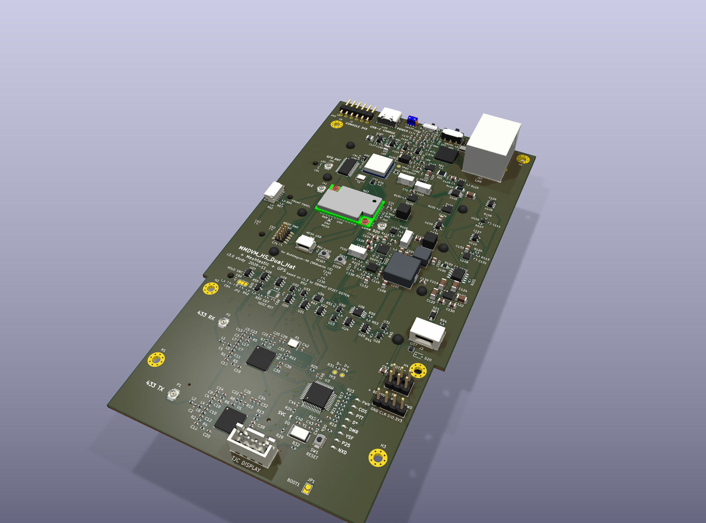

# MMDVM + Meshtastic + GPS + 18650 電池：可行性研究

研究日期：2026-11-14（分支 `meshtastic-gps-study`）
狀態：**研究／提案**，尚未開始畫線路。標「待確認」的項目需要實測或使用者決定。

## 0. 結論摘要

| 問題 | 結論 |
|---|---|
| 能不能加 Meshtastic？ | **可以，但 ADF7021 不能做 LoRa**，要另外加一顆 SX1262。台灣用 TW 區 920–925 MHz，跟熱點的 430–440 MHz 分得很開，互擾低。 |
| 現有板子塞得下嗎？ | **塞不下。** r1.3 上層最大空位約 7×11 mm，r2.0-mini 只有 65×30 mm、穩壓器 300 mA。需要出一張新板。 |
| 用 Bubblegum-96 當主機？ | **可以。** mainline kernel 沒有 S900 的 USB host、SPI 控制器、Wi-Fi DT、PMIC，但使用者自己的 kernel 已經補上 USB 和 Wi-Fi，目前用 USB 網卡上網，開關機正常。SPI 控制器仍然沒有，所以新板以 UART + I2C + GPIO 跟主機溝通，USB 只當選配（給 Meshtastic MCU 更新韌體）。 |
| Meshtastic 怎麼接？ | **建議板上放一顆 nRF52840 + SX1262，跑官方 Meshtastic 韌體**，GPS 接在它身上。不依賴 S900 kernel，主機關機時 Meshtastic 也能單獨用電池跑上一週左右。 |
| GPS 給誰用？ | GPS 由 Meshtastic MCU 控制；NMEA 同時分一路給主機（經 I2C 轉 UART），讓 gpsd、APRS／閘道器也拿得到位置。 |
| 4 顆 18650 並聯 + 供電給 Bubblegum？ | **可行，建議 1S4P。** 電池升壓到 12 V，經擴充座的 SYS_DCIN 反向餵 Bubblegum（96Boards 規格明確允許）。充電建議 USB-C PD 9 V，只用 5 V 的話，帶主機運作時幾乎充不進去。 |
| 螢幕 TJC8048X550 | 接 MMDVM 板的 NXT 透傳埠（STM32 USART2），`Port=modem`。**X5 系列的 TX 是 5 V，STM32 的 PA3 不耐 5 V，要串 1 kΩ**；排針腳序也跟 r1.3 相反。目前的 MMDVM-Host 已把螢幕功能拆到 MMDVM-Display（走 MQTT）。沒有現成 800×480 的 TJC 畫面檔，要自己用 TJC 編輯器做。詳見第 6 節。 |
| Meshtastic 小螢幕 | **可以，不用改韌體。** 官方韌體會自動偵測 I2C 0x3C 上的 OLED（Heltec V3 用 0.96 吋 SSD1306）。本案建議 1.3 吋 SH1106 128×64，放在 5 吋螢幕下方的前面板，MESH 按鍵在旁邊。詳見第 3.2 節。 |
| 外盒 | **3D 列印、直立式桌上型**：螢幕朝前、後仰 12°，四支天線從頂邊朝上，頂部 30 mm 風扇往上排風，底部進風形成煙囪氣流。5 吋螢幕下方有前面板（Meshtastic OLED＋MESH 鍵）。外形約 136（高）× 156（寬）× 52（深）mm。詳見第 7 節。 |

## 1. 需求

1. 保留 MMDVM_HS_Dual_Hat 的雙 ADF7021 雙工熱點功能（DMR／D-Star／YSF／P25／NXDN）。
2. 加 Meshtastic（LoRa，台灣 920–925 MHz）。
3. 整合 GPS。
4. 主機暫定 Bubblegum-96（Ubuntu 24.04，新版 kernel）。
5. 4 顆 18650 直接裝在板上，可充放電，同時供電給 Bubblegum-96。
6. 外盒，裝 TJC8048X550_011 5 吋螢幕給 MMDVM 用。
7. GPS 開關：硬體滑動開關斷電，加上 Meshtastic 的軟體切換（兩者都做；有 OLED 時軟體切換在 GPS 頁選單，見 10.4）。
8. 外盒用 3D 列印，要能立在桌上直接看螢幕。
9. 加小型散熱風扇，設計時考慮安裝與風道。
10. Bubblegum 的 TTL console 直接在板上做好接口，方便接 USB-TTL。
11. Meshtastic 要像 Heltec WiFi LoRa 32 V3 一樣有一塊小螢幕。

## 2. 主機：Bubblegum-96 現況

### 2.1 硬體
- Actions S900，85×54 mm（96Boards CE）。
- DC 輸入：線路圖標 8–18 V，手冊建議 12 V／2 A。插頭 4.8/1.7 mm。
- 沒有有線網路。Wi-Fi／BT 是 BCM43438。USB 3.0 A ×1、USB 2.0 A ×1、micro-USB OTG ×1。
- 已停產，市面上幾乎買不到。
- **耗電沒有公開數據，要實測**，下文先假設 3–8 W。

### 2.2 mainline kernel 支援（torvalds master 7.4-rc2）

| 功能 | 狀態 | 對本設計的影響 |
|---|---|---|
| UART（owl-uart） | 有。uart5 當 console，其餘預設關閉 | 擴充座 UART0 要用 DT overlay 打開 |
| I2C（owl-i2c） | 有，i2c1／i2c2 已啟用 | 可直接用 |
| GPIO／pinctrl | 有 | 可直接用（libgpiod） |
| SPI 控制器 | **沒有驅動** | 不用硬體 SPI；Meshtastic 改用板上 MCU |
| USB host | mainline **沒有**；**使用者的 kernel 已補上**，USB 網卡可用 | 主要介面不靠 USB；USB 只用在選配功能 |
| Wi-Fi（SDIO） | 驅動有，mainline DT 沒啟用；**使用者的 kernel 已可用** | 外盒用塑膠（3D 列印），Wi-Fi 不會被擋 |
| PMIC | mainline 沒有驅動；使用者表示開關機正常 | 本板偵測 LS +1V8（pin 35）消失，就關掉 12 V（待實測）；`gpio-poweroff` 當備案 |

> **使用者回報（2026-11-14）：** 自行維護的 kernel 已讓 Wi-Fi 與 USB 正常，目前用 USB 網卡上網，開關機正常。仍要注意：USB 2.0 A 口不支援 hub，USB 網卡最好插在 USB 3.0 口或 USB 2.0 口直插。
>
> **實測先跳過（使用者決定，2026-11-14）。** 設計改成兩種情況都能應付，板子做好後再用板子本身量：
>
> | 未知數 | 設計怎麼處理 |
> |---|---|
> | 12 V 耗電 | 12 V 升壓照 18 W（12 V／1.5 A）設計；輸出端加 INA226 電流／功率監測，主機直接讀實際耗電 |
> | 關機後 +1V8 會不會掉 | 偵測 +1V8 消失**或**主機用 `gpio-poweroff` 拉 KILL，任一成立就延遲斷 12 V；長按電源鍵強制斷電當最後手段 |
> | SYS_DCIN 上電會不會自動開機 | 預留電路接 LS pin 4（PWR_BTN_N），12 V 送上後由本板代按一次開機鍵；用不到就不焊 |
> | S900 位置 | 氣流本來就流過整片 Bubblegum；散熱片用黏貼式；風扇的溫度感測放在 SoC 柱的出風口，不依賴 SoC 確切位置 |

### 2.3 擴充座（96Boards LS，40-pin，2.0 mm）
- **所有訊號都是 1.8 V**，跟 3.3 V 的元件之間要加電壓轉換。
- 板間距 8 mm，建議 4 根 M2.5 × 8 mm 銅柱。主機板端是 Molex 87381-4063 母座，擴充板端用 Molex 87831-4029 或同等品。
- SYS_DCIN（pin 36、38）：擴充板可以反向供電給主機板，規格允許 8–18 V，建議 12 V。**Bubblegum 的 SYS_DCIN 跟 DC 插座直接相連，沒有 OR-ing**，所以我們的 12 V 出口必須加理想二極體。
- +1V8（pin 35）：最多 0.1 A，只拿來當電壓轉換晶片的 1.8 V 參考。

## 3. 系統架構（建議）

```
                 ┌──────────────── Bubblegum-96（Ubuntu 24.04）────────────────┐
                 │ LS UART0（S900 UART2，1.8 V） I2C0（S900 I2C1） GPIO-A..L  SYS_DCIN │
                 └──────┬─────────────────────┬──────────────┬──────────▲────────┘
                  電壓轉換 1.8↔3.3 V      TCA9406         電壓轉換        │ 12 V
                        │                     │              │            │
   ┌────────────────────▼───┐   ┌─────────────▼─────────┐    │      ┌─────┴──────┐
   │ MMDVM（沿用 r1.3 線路） │   │ 3.3 V I2C 匯流排        │    │      │ 電源（第 4 節）│
   │ STM32F103 + 2×ADF7021   │   │ SC16IS752 雙 UART ─A──┼────┼──┐   └────────────┘
   │ TCXO 14.7456 MHz        │   │ BQ25895 充電 IC        │    │  │
   │ USART2 → TJC 螢幕（XH）  │   │ MAX17048 電量計         │    │  │
   │ SMA ×2（433 TX／RX）     │   └───────────────────────┘    │  │ B（只收 NMEA）
   └─────────────────────────┘                                 │  │
                                     ┌─────────────────────────▼──▼────┐
                                     │ Meshtastic：nRF52840 + SX1262    │
                                     │ 官方韌體，BLE 給手機 App            │
                                     │ GPS（L76K／MAX-M10S）──NMEA──┬──→ │
                                     │ SMA（920 MHz），GPS SMA（有源天線） │
                                     └──────────────────────────────────┘
```

### 3.1 MMDVM
- 沿用 r1.3 的 STM32／ADF7021 線路與射頻佈局，這是驗證過的設計。原本 5 V → 3.3 V 的 LDO 改成第 4 節的電源。
- 主機連線：LS UART0（TX／RX，RTS／CTS 預留）。韌體設定維持 `STM32_USART1_HOST`。
- 燒錄：`stm32flash -i` 用 GPIO-A 控制 BOOT0、GPIO-B 控制 NRST。S900 的 sysfs GPIO 編號從 512 以上起跳，要查 `/sys/class/gpio/gpiochip*/base`；ttyOWL 的 RTS／DTR 不能用軟體控制。
- 備註：雙工模式要求收發頻率相差至少 5 MHz，韌體 README 也提到 DMR 有已知問題。

### 3.2 Meshtastic：三個方案

| | **A. 板上 MCU（建議）** | B. 主機跑 meshtasticd（軟體 SPI） | C. 主機跑 meshtasticd（CH341 USB） |
|---|---|---|---|
| 硬體 | nRF52840 + SX1262（模組），跑官方韌體 | SX1262 模組接 LS SPI0 | 板上 CH341 USB 轉 SPI + SX1262，接主機 USB |
| 主機依賴 | 不依賴，主機關機也能用 | 要 spi-gpio DT overlay（未驗證），外加 BUSY／IRQ／RESET GPIO | 要主機 USB（使用者的 kernel 可用），多一條 USB 線 |
| 手機 App | BLE 直連 | 要經主機網路 | 要經主機網路 |
| 主機關機時 | 繼續跑（約 0.15 W，第 4.4 節） | 停止 | 停止 |
| 韌體 | 沿用官方 variant 的腳位配置，就不用維護 fork | meshtasticd，Ubuntu noble arm64 有 PPA | meshtasticd 2.5.18 起支援 `spidev: ch341` |
| 主機存取 | 透過 SC16IS752 UART-A，可用 Meshtastic CLI／Python API；USB 選配 | 原生 | 原生 |

**為什麼選 A：** S900 沒有硬體 SPI；B 要靠未驗證的軟體 SPI，C 要多佔一個 USB 口（USB 2.0 口不支援 hub）。A 只需要 UART，風險最低。另外，用電池時可以把主機關掉、只留 Meshtastic 跑，續航從幾小時拉長到一週左右。nRF52840 的 USB 拉到板上的內部排針，需要時可以接主機或電腦更新韌體。

**已定案：RAK4630 模組，腳位照官方 `rak4631` 板型**（見第 10 節）。

#### Meshtastic 小螢幕（使用者需求，2026-11-14）

- **可行，不用改韌體：** Meshtastic 官方韌體開機時會偵測 I2C 位址 0x3C 上的 OLED，自動顯示節點、訊息、位置等頁面。
  - Heltec WiFi LoRa 32 V3 板上就是 0.96 吋 128×64 SSD1306。
  - nRF52840 板型一樣支援，例如 RAK4631 的 OLED 擴充模組就是 SSD1306。
- **建議 1.3 吋 SH1106 128×64：**
  - 介面、解析度跟 0.96 吋相同，但字大約 1.4 倍，放桌上約 50 cm 外看比較清楚。
  - 可視區約 29.4×14.7 mm，面板外形約 34.5×23 mm（依實際料號確認）。
  - 也可以用跟 Heltec 一樣的 0.96 吋 SSD1306，外盒開窗改小即可。
- **接法：** 接在 **nRF52840 的 I2C**（不是主機的 I2C），照所選官方板型定義的 SDA／SCL 腳位，韌體才會自動抓到。
- **操作：** MESH 按鍵移到 OLED 旁邊。有螢幕時，官方韌體按一下切下一頁、按住 0.5 秒開選單、按住約 3.9 秒關機；**連按三下切 GPS 只在沒有螢幕時有效**（見 10.4）。
- **耗電：** OLED 亮著時約 10–25 mA（依亮點多寡），韌體閒置一段時間會自動關螢幕，按鍵喚醒；對主機關機時一週左右的續航影響很小。
- **不建議改用 Heltec V3 的 ESP32-S3：**
  - 雖然多了 Wi-Fi，但耗電約是 nRF52840 的 5–10 倍，只跑 Meshtastic 時的續航會從一週掉到一兩天。
  - Meshtastic 要上 MQTT 的話，可以用 MQTT Client Proxy 借主機或手機的網路。
- **機構：** 5 吋螢幕四周邊框只有約 8–13 mm，放不下 OLED。所以外盒底部往下加高 26 mm，做成前面板（「下巴」）：
  - OLED 模組直接用 4 根 M2 螺柱鎖在前蓋上，用 4 線杜邦線接到前面板小板。小板放 MESH 按鍵和藍燈，用 6-pin JST-SH 排線（3.3 V、GND、SDA、SCL、按鍵、藍燈）接回主板 J44（見 10.6）。
  - 下巴的空腔剛好是底部進風口後面的進氣室，兩個氣流柱的進風更均勻。

### 3.3 GPS
- 候選模組：
  - Quectel L76K：UART，約 25 mA，Meshtastic 可自動偵測。
  - u-blox MAX-M10S：UART／I2C，約 10 mA，有 LNA_EN 與 VCC_RF，可直接供電給有源天線。
- 天線：**建議用 SMA 外接有源天線。** 機殼內有 SoC、DC-DC 和高階時脈諧波（見第 5 節），板載陶瓷天線容易受干擾。
- GPS 的 TX 分兩路：一路接 Meshtastic MCU（它負責設定 GPS），另一路接 SC16IS752 UART-B，只收 NMEA，主機用 gpsd 讀。注意：Meshtastic 的省電模式可能關掉 GPS，主機那邊就收不到；要設定 GPS 常開。
- PPS 經電壓轉換接到一根 GPIO，主機可以用 `pps-gpio` + chrony 校時。主機沒有 RTC、沒網路時特別有用。

#### GPS 開關（使用者需求，2026-11-14）

外殼上加一個滑動開關，決定 GPS 模組要不要開。

- **線路：** GPS 電源 = 滑動開關 **AND** Meshtastic MCU 的 GPS_EN，經負載開關（TPS22916 類，或 P-MOSFET）供給 GPS VCC。
  - 開關 OFF：GPS 完全斷電，不會有位置，最省電。
  - 開關 ON：交給 Meshtastic 控制，它的省電模式照常運作。
- **備援電源：** GPS 的 V_BCKP 腳由常開的 3.3 V 經二極體供電。開關關掉時星曆仍保留，再打開可以熱啟動，幾秒內定位。
- **指示燈：** 開關旁一顆綠色 LED，GPS 有電就亮；也可以改接 PPS，定位後每秒閃一次。
- **讓韌體知道：** 開關狀態經電壓轉換接到主機 GPIO-I。
  - 主機上的小服務偵測到切換後，用 GPIO-G 重開 Meshtastic MCU，讓韌體重新偵測 GPS。
  - Meshtastic 主要在開機時偵測 GPS，執行中插拔的行為要用實機確認。
  - 主機沒開時，切到 ON 會在 Meshtastic 下次重開後生效。
- **軟體開關（使用者決定兩者都做）：** 「MESH」按鍵（在正面 OLED 旁邊）接 RAK4631 的 user button（P0.09）。因為有 OLED，軟體切換是「切到 GPS 頁 → 按住 0.5 秒 → Toggle GPS」；沒有螢幕時才是連按三下。
  - 兩者的關係：硬體開關 OFF 時 GPS 一定沒電；開關 ON 時，可以用選單在軟體上開關 GPS。
  - 外殼標示：按一下＝下一頁、按住＝選單、長按約 4 秒＝Meshtastic 關機。
- **注意：** 主機的 gpsd 也吃同一顆 GPS，所以開關 OFF 時，APRS／閘道器的位置也會停。
- **想要 GPS 開著、但 Meshtastic 不廣播位置：** 這要用軟體設定，例如 App 裡的 `position.gps_mode`、位置精度、固定位置，不需要硬體開關。
- MMDVM-Host 本身已經沒有 GPSD；位置功能在 DMRGateway、YSFGateway 等閘道器，要編譯時打開 `USE_GPSD`。WPSD 手冊（2026-11）說它的 gpsd 功能目前不能用。

### 3.4 主機腳位分配（提案）

| LS pin | 功能 | 接到 |
|---|---|---|
| 5、7（9、3） | UART0 TX／RX（RTS／CTS） | STM32 USART1，MMDVM 主機連線 |
| 11、13 | UART1（console，ttyOWL5，115200） | 1.8↔3.3 V 轉換 → **外盒側面的 console 接頭**（第 3.5 節） |
| 15、17 | I2C0 | TCA9406 → SC16IS752（0x48）、BQ25895（0x6A）、MAX17048（0x36）、INA226 12 V 監測（0x40）、AMC6821 風扇控制（位址依 ADDR 腳） |
| 19、21 | I2C1 | 保留 |
| 8、10、12、14 | SPI0 | 保留（方案 B 用） |
| 4 | PWR_BTN_N | 本板電源控制代按開機鍵（open-drain，預留、可不焊） |
| 6 | RST_BTN_N | 預留：板上小按鍵 HOST RESET（open-drain，可不焊） |
| 23 GPIO-A | 輸出 | STM32 BOOT0 |
| 24 GPIO-B | 輸出 | STM32 NRST |
| 25 GPIO-C | 輸入 | SC16IS752 IRQ |
| 26 GPIO-D | 輸入 | 充電 IC INT、電量計 ALRT（open-drain 共線） |
| 27 GPIO-E | 輸入 | 電源鍵 INT（要求關機） |
| 28 GPIO-F | 輸出 | KILL 備案（`gpio-poweroff`）；主要靠偵測 +1V8 |
| 29 GPIO-G | 輸出 | Meshtastic MCU RESET |
| 30 GPIO-H | 輸入 | GPS PPS |
| 31 GPIO-I | 輸入 | GPS 開關狀態 |
| 32 GPIO-J | 輸入 | 風扇控制器 ALERT／THERM |
| 33–34 GPIO-K..L | — | 預留 |
| 35 | +1V8 | 電壓轉換晶片 A 側參考 |
| 36、38 | SYS_DCIN | 本板 12 V 出口（經理想二極體） |

### 3.5 Bubblegum console 接頭（使用者需求，2026-11-14）

使用者目前用 USB-TTL 操作 Bubblegum 的 console，希望直接在這張板上做好接口。

- **訊號來源：** LS pin 11（UART1_TxD）、pin 13（UART1_RxD），即 S900 UART5／`ttyOWL5`，115200 8N1。
- **一定要轉電位：** 擴充座是 **1.8 V**，一般 USB-TTL 是 3.3 V 或 5 V，直接接會傷到 S900。
  - 用固定方向的雙電源轉換晶片：兩顆 SN74LVC1T45，或一顆每位元可設方向的 SN74AXC4T774。
  - A 側接 LS +1V8（pin 35），B 側接本板 3.3 V。
  - 這類晶片有 Ioff 斷電隔離：任一側沒電時兩邊都是高阻抗。Bubblegum 關機時，插著的 USB-TTL 不會經 RX 倒灌、讓 SoC 處於半上電狀態；本板沒電時也一樣。
  - B 側輸入可耐 5 V，輸出 3.3 V，所以 3.3 V 和 5 V 的 USB-TTL 都能用（建議設在 3.3 V）。
- **接頭：** 6-pin 2.54 mm 臥式排針，腳序照 FTDI 線（TTL-232R-3V3）。FTDI 線可以直接插；4-pin 的 CH340／CP2102 小板用杜邦線接 GND、TXD、RXD 三條。

  | Pin | 名稱 | 說明 |
  |---|---|---|
  | 1 | GND | |
  | 2 | CTS | 不接 |
  | 3 | VCC | **不接**（避免 USB-TTL 的 5 V／3.3 V 灌進板子） |
  | 4 | TXD（電腦→Bubblegum） | 經轉換到 LS pin 13 |
  | 5 | RXD（Bubblegum→電腦） | 由 LS pin 11 轉換而來 |
  | 6 | RTS | 不接（避免終端機程式切 DTR／RTS 時誤觸 reset） |

- **位置：** 主板延伸端的板邊，直立時在左側面最下方。外盒開 17.4×4.0 mm 的孔，杜邦／FTDI 線頭可以從外面直接插進去，不用拆殼。外殼旁邊壓印「CONSOLE 3.3V」和腳位。
- **選配：** 板上直接放 CH340／CP2102N＋USB 接頭，一條 USB 線就能接電腦（由 USB 供電，不受本板開關影響）。這樣會多一個 USB 口，跟充電用的 USB-C 容易混淆，先列為選配。
- **另外保留：** STM32 的 SWD 接點（原 r1.3 的 STlink 排針），MMDVM 韌體變磚時可以救回；放在板內，不開外盒孔。

## 4. 電源：1S4P

### 4.1 為什麼選 1S4P（4 顆並聯）
- 並聯不用平衡充電，使用者自己換電池也不會出現串聯電芯不平衡的問題。
- 4 顆分攤電流：最壞情況電池端約 4.4 A，每顆約 1.1 A，電池座接點壓力小。
- 1S 的充電 IC、保護 IC、電量計選擇最多、最便宜。
- 代價：要升壓到 12 V，效率約 88–91%；電池到升壓器之間電流大，走線要粗。
- 2S2P 或 4S 在本案不划算：要平衡電路，使用者換電池時也容易造成電芯不平衡。

### 4.2 方塊圖

```
USB-C ─TVS─ CH224K（PD 誘騙，要 9 V；來源不支援就退回 5 V）
              │ VBUS 5–9 V
              ▼
        BQ25895（1S，NVDC 電源路徑，最大充電 5 A，I2C）── TS ← 10 k NTC（貼在電池之間）
              │ VSYS 3.5–4.35 V（拔掉電池也能從 USB 繼續供電）
              │ BAT
              └─ BQ2980 高側保護（1 mΩ 取樣）─┬─ 保險絲 ─ 18650 #1（Keystone 1042P 有極性電池座）
                                              ├─ 保險絲 ─ 18650 #2
                                              ├─ 保險絲 ─ 18650 #3
                                              └─ 保險絲 ─ 18650 #4    MAX17048 電量計跨在電池上
  VSYS ──┬─ TPS61178 升壓 12 V／1.5 A（有 load disconnect）─ INA226 監測 ─ LM74700 理想二極體 ─ SYS_DCIN → Bubblegum
         ├─ TPS61022 升壓 5 V／2 A ─┬─ TJC 螢幕（XH 4-pin）
         │                          └─ AMC6821 → N-MOSFET → 30 mm 風扇（溫控、轉速回授）
         └─ TPS63020 升降壓 3.5 V（固定 2.4 MHz，可同步）─ π 濾波 ─┬─ LDO 3.3 V → STM32＋ADF7021
                                                                  ├─ LDO 3.3 V → nRF52840＋SX1262（常開電源域）
                                                                  └─ LDO 3.3 V → 負載開關（GPS 開關 AND GPS_EN）→ GPS
                                                                                 └→ V_BCKP（常開，保留星曆）
  電源鍵控制（LTC2954 類）：按鍵 → INT 通知主機 → 主機關機 → LS +1V8 消失「或」gpio-poweroff 拉 KILL → 延遲後關 12 V／5 V
  長按電源鍵：強制斷電；開機時（預留）代按 LS PWR_BTN_N
  Meshtastic + GPS 的電源域獨立，可以不跟主機一起關
```

### 4.3 選料理由

| 功能 | 料號 | 理由 |
|---|---|---|
| 充電 | **BQ25895** | 1S，3.9–14 V 輸入，5 A 充電，NVDC 電源路徑，LCSC C80200 便宜。I2C watchdog 逾時後會恢復預設值（2 A、4.208 V），不接主機也能安全充電。 |
| PD 誘騙 | CH224K | 用電阻設定要 9 V，簡單（LCSC C970725）。進階可換 STUSB4500。 |
| 保護 | BQ2980 | 高側 N-FET，GND 不中斷，用取樣電阻精準設定過流（例：8 A）。比 DW01A＋8205A（約 2.5–4 A 就會跳）適合 4P。 |
| 每顆保險絲 | SMD 5–7 A（NANO2 類） | 有人把電池裝反時，其他 3 顆對它短路，靠這顆熔斷。 |
| 電池座 | Keystone 1042P ×4 | SMT、有極性（第一道防反插），77.1×20.7 mm，高 14.86 mm。沒有公布額定電流，每顆 1.1 A 在合理範圍，仍要實測溫升。 |
| 電量計 | MAX17048 | 1S，不用取樣電阻，ALRT 腳接主機。 |
| 12 V | TPS61178 | 2.7–20 V 輸入，峰值電流可設到 10 A，有 load disconnect（關機真正斷電），可外部同步。 |
| 12 V 防逆流 | LM74700-Q1 + N-FET | 防止有人同時把變壓器插在 Bubblegum 上時倒灌。 |
| 5 V | TPS61022 | 8 A 谷值限流，3.6→5 V 約 95%。 |
| 3.3 V | TPS63020 → 3.5 V，再接 LDO | 固定 2.4 MHz、可同步，好規劃頻率。射頻每區各一顆 LDO（TPS7A20 類）。 |

### 4.4 電流與續航估算（3000 mAh 電芯 ×4 = 43 Wh，可用約 39 Wh）

| 負載 | 估計 | 電池端 |
|---|---|---|
| Bubblegum-96（12 V） | 3–8 W **待實測** | 3.3–9.1 W |
| TJC 5 吋螢幕（5 V） | 背光 0 約 150 mA，全亮約 280–330 mA → 0.75–1.65 W | 0.8–1.8 W |
| MMDVM＋Meshtastic＋GPS（3.3 V） | 約 0.7 W | 約 0.9 W |
| Meshtastic OLED（3.3 V，亮著時） | 10–25 mA → 0.03–0.08 W | 約 0.1 W |
| 風扇（5 V，溫控） | 0–0.6 W | 0–0.65 W |
| **合計** | | **約 5–12.5 W → 續航約 3–7.5 小時** |
| 主機關機，只跑 Meshtastic＋GPS | 約 0.15 W | **約一週** |
| 主機關機，Meshtastic 開、GPS 開關 OFF | 約 0.05–0.1 W | **約兩週以上** |

- 最壞情況電池端電流：12.5 W ÷ 3.0 V ≈ 4.2 A，每顆約 1.05 A。
- **充電：** PD 9 V／3 A（27 W）時，扣掉系統用電，約 3–4.5 A 可以充進電池 → 約 3.5–4.5 小時充滿。
- **只有 5 V／3 A（約 13.5 W）時，主機開著幾乎沒有餘力充電**，螢幕全亮時甚至還在放電。所以 PD 是必要的。

### 4.5 安全注意
- **換電池時，4 顆電壓要接近**（相差 0.1 V 以內）再裝。並聯時，電壓高的會對電壓低的大電流灌電，每顆保險絲是最後防線。外殼要貼警示。
- 18650 有保護板版本長約 69–70 mm，要確認裝得進電池座；**建議用無保護板的平頭電芯**，由板上的保護 IC 負責。
- NTC 要貼在電池之間，接充電 IC 的 TS 腳（JEITA）。電池要遠離 SoC 和升壓電感的熱。
- 長期插電當 UPS 用時，建議主機開機後用 I2C 把充電電壓降到 4.1 V，延長電池壽命。
- 主機要讀電量計，低電量時自動關機；BQ2980 欠壓保護是最後防線。

## 5. 射頻共存

| 來源 | 頻率 | 結果 |
|---|---|---|
| ADF7021 熱點 | 430–440 MHz | 2 倍頻 860–880 MHz、3 倍頻 1290–1320 MHz，都不落在 920–925 或 GPS L1 |
| LoRa TW | 920–925 MHz | 2 倍頻 1840–1850 MHz，不落在 GPS |
| 互調（\|m\|+\|n\|≤5） | 熱點 × LoRa | 沒有產物落在 GPS L1／BDS B1I／GAL E1 |
| TCXO 14.7456 MHz | 第 107 次諧波 1577.78 MHz | 距 GPS L1 約 2.4 MHz，很弱 |
| Y1 8 MHz（STM32） | 第 197 次諧波 1576.00 MHz | 距 L1 約 0.6 MHz，極弱，但 GPS 天線仍要外接 |
| DC-DC 開關頻率 | 0.75–2.4 MHz | GPS 頻帶內一定會有某次諧波，靠佈局、屏蔽、濾波處理；所有 DC-DC 同步在同一時脈 |

- 天線：433 TX、433 RX、920 LoRa、GPS，共 4 個 SMA。LoRa 天線跟 433 天線盡量拉開距離。
- Bubblegum 的 Wi-Fi 天線在板上，**外殼不要用全金屬**，或在 Wi-Fi 位置留塑膠窗。

### 法規備註（台灣）
- Meshtastic 韌體的 TW 區：920–925 MHz、上限 27 dBm、佔空比 100%。
- NCC LP0002 第 5.8.1 節：920–925 MHz 室內 ≤1 W、室外 ≤0.5 W，但**只適用跳頻，或 6 dB 頻寬 ≥500 kHz 的數位調變**。Meshtastic 預設 LongFast 是 250 kHz 頻寬，有可能落入第 5.8.2 節（3 m 處 50 mV/m）這個嚴格得多的限制。**這是我的解讀，要請 NCC 認可的實驗室確認。**
- 授權業餘電台可以考慮 Meshtastic 的 licensed 模式，但頻段與調變方式要另外依業餘電台法規確認。

## 6. 螢幕 TJC8048X550_011

來源：TJC X5 規格書（`TJC8048X550_011R/N/C.pdf`，p.7–14）、TJC wiki FAQ（QA3／QA110）、g4klx/MMDVM-Display、juribeparada/MMDVM_HS。

### 6.1 規格

| 項目 | 數值 |
|---|---|
| 面板 | 5.0 吋 800×480，TN，300 nit；視角上／下／左／右 50／70／70／70° |
| 系列 | X5（TJC 最高階）：ARM9 200 MHz、128 MB flash、512 KB RAM、RTC、8 GPIO、音訊 |
| 後綴 | `_011R` 電阻觸控、`_011C` 電容觸控、`_011N` 無觸控。**使用者的這片是 R（電阻觸控）**：板上只印 `TJC8048X550_011`，但觸控排線 HST050008 是 4 pin（4 線電阻觸控）；面板另印 HST050040 |
| 電源 | 4.65–6.5 V（建議 5 V／1 A）；全亮 R 330 mA／N 327 mA／C 281 mA，背光 0 約 150 mA |
| UART | **5 V TTL**（X3／X5 是 5 V，其他系列 3.3 V），預設 9600 8N1，可到 921600；`bauds=` 寫入開機預設值 |
| 接頭 | XH2.54 4-pin 臥式：**1 GND、2 RX、3 TX、4 5V** |
| 外形 | 裸板無外框；PCB 136.90×84.00 mm（R3 圓角），Ø3.2 孔 ×4，孔距 130.50×77.60 |
| 顯示區 | LCD 外框 120.70×75.80；可視區 108.00×64.80，短邊方向偏離中心約 1.9 mm |
| 厚度 | 前方疊層 N 3.3／R 4.5／C 5.08 mm；PCB 1.6；背面最高 6.0（XH 接頭）→ 總深約 10.9／12.1／12.7 mm |
| 其他 | 背面有 microSD（更新 TFT 用）；工作溫度 −20～+70 °C |

### 6.2 接線注意（本板要改的地方）

- **5 V 的 TX 不能直接進 STM32 PA3：** PA2／PA3 不耐 5 V。TJC 官方建議串 1 kΩ；新板在螢幕 TX → PA3 之間放 1 kΩ（或單向電壓轉換）。反方向 PA2 → 螢幕 RX 是 3.3 V 訊號，螢幕可以直接收。
- **腳序：** r1.3／r2.0 的 NXT 排針是 1=5V、2=RXD、3=TXD、4=GND，跟 TJC 的 XH 剛好相反，1:1 線會把 5 V 接到螢幕 GND。**新板改用 XH 4-pin、腳序照 TJC（1 GND、2 螢幕 RX、3 螢幕 TX、4 5V）**，用一般 1:1 XH 線就好。
- **電源：** 由 5 V 升壓（TPS61022）供電，約 0.33 A。

### 6.3 軟體

- **MMDVM_HS 韌體：** Dual Hat 的設定檔已定義 `SERIAL_REPEATER`（USART2、PA2／PA3、9600）。發送緩衝 256 bytes，滿了會**直接丟資料**，沒有流量控制。800×480 畫面欄位多，建議重編韌體把 `SERIAL_REPEATER_BAUD` 調高（例如 115200），螢幕端用 `bauds=115200` 配合。
- **MMDVM-Host：** 2023-06 起螢幕程式碼已移到 **MMDVM-Display**，透過 MQTT 取得資料（要 mosquitto）。設定檔 `[Nextion]`：`Port=modem`、`ScreenLayout` 只剩 0／2／3。也可以用 2023-06 以前的 MMDVMHost（`[Nextion] Port=modem`）。
- **ON7LDS NextionDriver：** 支援 modem 埠，但跟新版 MMDVM-Display 分拆後的設定能不能一起用，**尚未驗證**。
- **畫面檔：** 找不到現成的 TJC 800×480 MMDVM 畫面。
  - Nextion 的 `.tft` 不能用在 TJC 上；`.HMI` 匯入 TJC 編輯器的回報不一致。
  - PD0DIB 有 Nextion 5 吋 800×480 版本可參考，但只適用 Nextion，而且授權禁止商用。
  - 要用 TJC 的 USART HMI 編輯器（中文介面）照 G4KLX／ON7LDS 的頁面與欄位名稱自己做。
- **編碼：** TJC 預設 GB2312；MMDVM 送溫度時的「°」是單一位元組 176，可能顯示成亂碼，要調字型編碼或改顯示方式（未實測）。
- **更新畫面檔：** 透過螢幕背面的 microSD（要拆前蓋），或用 USB-TTL 接 XH。經 MMDVM 透傳埠應該無法更新（推論）。
- **社群經驗：** 有人在 Pi-Star 用 3.2 吋 TJC 搭 `Port=modem` 成功；沒找到 X5／800×480 TJC 搭 MMDVM 的案例。

## 7. 機構與外盒（概念）

使用者決定：**3D 列印**、**直立在桌上直接看螢幕**、加**小型散熱風扇**。

- 模型：`case/meshtastic-concept/enclosure_concept.py`（CadQuery 2.8，參數化）。輸出 STEP 組合檔、四個列印零件的 STL／STEP 與預覽圖；STL／STEP 不進 git，跑腳本就會重新產生。
- 細部設計已完成第一版（7.6 節），可以試印。**尚未實際列印驗證**，公差和螺母孔徑要印一次後再調。
- 已用程式檢查零件之間的干涉（實體交集體積），目前為 0。
- 材料：**PETG 或 ASA，不要用 PLA**。PLA 約 55–60 °C 就會軟化，盒內有 SoC、升壓電路和鋰電池。

### 7.1 方向與疊層

- **直立：** 螢幕朝前，機身後仰 12°。
  - Bubblegum 的 x=85 長邊（96Boards 規格的 Wi-Fi 天線區）朝上，對 Wi-Fi 有利。
  - 原本的「底殼」變成背面，電池蓋在背面。
- **由後往前：** 背板 → Bubblegum-96 → 8 mm → 主板 → 螢幕 → 前蓋。
  - 主板是 L 形：在 Bubblegum 上方 85 mm 寬，電池區加寬到 90.5 mm（x −2～88.5），總長 154 mm（y −1～153）。加入 RJ45 後再加長到 167 mm（y −1～166），見第 11 節。延伸區背面放 4 顆 18650（Keystone 1042P，禁區 88×21.75 mm，間距 21.8 mm），**電池直立**。
- **兩根氣流柱：**
  - SoC 柱：Bubblegum 那一側，主板上方是 MMDVM 區。
  - 電池柱：電池那一側，主板上方是 Meshtastic／GPS（下段）和電源區（上段，熱往上直接排出，不經過電池）。
- **固定方式：**
  - 背板立柱鎖 Bubblegum 四孔（M2.5），主板延伸端另有兩孔在最後一顆電池座外側。
  - Bubblegum 與主板之間用 8 mm 銅柱。
- **外殼結構：** 「桶身＋前蓋」兩件。
  - 桶身：背板＋四面牆，所有側面開孔、SMA、風扇都在這一件，強度最好。
  - 前蓋：裝螢幕。用 4 根 M3 螺絲鎖到桶身的熱熔螺母；兩根在頂部空腔，兩根在加厚的底邊（7 mm），都避開電路板，整疊電路板可以從前面直接放進去。
- **前面板（下巴）：** 5 吋螢幕下方加高 26 mm，放 1.3 吋 OLED（Meshtastic）和前面板小板（MESH 按鍵＋藍燈），細節見 10.6。
- **外形：** 約 136（高）× 176（寬）× 52（深）mm（加入 RJ45 前是 163 mm 寬）；含天線站高約 360 mm。

### 7.2 天線（頂邊，垂直朝上）

- 面板式（bulkhead）SMA 母座鎖在頂牆，主板與 GPS 端用 IPEX（u.FL）座，中間接 IPEX→SMA pigtail（1.13 mm 線，約 10–15 cm）。天線的重量和扭力由外殼承受。
- 開孔 Ø6.5 mm D 形孔（平邊 5.9 mm）止轉，適用 1/4"-36 牙 bulkhead SMA。**實際尺寸依採購的接頭再確認。**
- 頂部有約 13 mm 的空腔（plenum）放接頭本體和 pigtail，主板上不需要再留天線禁區。

| 頂邊位置（由 Bubblegum 端算起） | 天線 | 備註 |
|---|---|---|
| y≈12 | 433 TX | 跟 RX 分在兩端，相距約 116 mm |
| y≈23–53 | （風扇） | 在 SoC 柱正上方 |
| y≈70 | GPS | 接外接有源天線（磁吸，拉到窗邊）；也可在頂部空腔放有源陶瓷天線、朝上收訊 |
| y≈100 | LoRa 920 | 鞭狀天線約 11 cm |
| y≈128 | 433 RX | |

- 直立後天線本來就是垂直的，用直的鞭狀天線即可（或可轉向的款式方便微調）。433 MHz 天線約 19–20 cm。

### 7.3 散熱與風道

**熱源估計：**
- SoC 3–8 W（待實測）。
- 螢幕 0.75–1.65 W。
- 電源轉換損耗 0.5–1 W；快充時充電 IC 另外約 1.5–2 W。
- 射頻與 MCU 約 0.7 W。
- 合計約 6–12 W。

**為什麼要風扇：**
- 外殼表面積約 0.06 m²，自然對流加輻射約 8–10 W/m²K，平均溫升約 10–20 °C，熱點更高。
- 夏天 35 °C 室溫時，盒內會超過 50 °C，超出鋰電池充電的 45 °C 上限（JEITA）。

**風量需求：**
- 用 CFM ≈ 1.76 × W ÷ ΔT(°C) 估算：10 W、允許溫升 10 °C，約需 1.8 CFM。
- 30 mm 風扇自由風量約 3–5 CFM（依型號），扣掉格柵損失仍夠用。

**風扇：**
- 30×30×10 mm、5 V，選低噪音、有轉速訊號的型號。
- 鎖在頂牆內側（頂部空腔，24 mm 孔距），**往上排風**，格柵直接印在頂牆上。

**風道：**

```
   頂牆：  [TX]  [風扇↑排風]  [GPS]  ‖  [LoRa] 〃〃被動散熱槽〃〃 [RX]
            ┌──────── SoC 柱 ────────┐‖┌──────── 電池柱 ────────┐
            │ ↑ Bubblegum 與主板間 8 mm │‖│ ↑ 電源區（上段）        │
            │ ↑ 夾層＝煙囪，經過 SoC    │‖│ ↑ Meshtastic／GPS（下段）│
            │ ↑ 散熱片（≤6 mm，規格允許）│‖│ ↑ 4 顆 18650（背面）    │
            │ ↑ 前方：MMDVM 區、螢幕背面 │‖│ ↑                       │
            └──────────────────────────┘‖└──────────────────────────┘
   底邊：  〃〃 進風槽 〃〃               ‖  〃〃 進風槽 〃〃   （支架留 8 mm 進風間隙）
                             頂部空腔隔板 ‖
```

- **SoC 柱：** 底邊進風 → 往上經過 Bubblegum 與主板之間的 8 mm 夾層（S900 上加 ≤6 mm 散熱片，96Boards 規格允許），以及前方的 MMDVM 區和螢幕背面 → 風扇抽出。背板在 SoC 後方也開進風槽。
- **電池柱：** 底邊進風 → 自然對流往上 → 頂牆被動散熱槽。電源區在這一柱的上段，熱往上走、不經過電池。
- **頂部空腔隔板**（y≈56）讓風扇主要抽 SoC 柱，SoC 的熱風不會繞到電池那邊。
- **控制：** 用 **AMC6821**（I2C 風扇控制器，mainline Linux 有 hwmon 驅動）。
  - 內建溫度曲線，主機當掉也會自己轉；有轉速回授。
  - 遠端溫度用一顆 MMBT3904，放在主板背面、正對 SoC 散熱片的出風側。
  - ALERT 接 GPIO-J。
  - 快充時由主機強制提高轉速。
  - 簡化版：溫度開關＋主機 GPIO（OR）控制 MOSFET。
- 底邊進風口可加防塵濾網。
- **驗證：** 35 °C 環境下用熱電偶量 SoC、電池、充電 IC、升壓電感；電池要維持在 45 °C 以下。

### 7.4 螢幕安裝（前蓋）

- 前蓋開窗 = 可視區 108.0×64.8 mm 每邊再加 0.5 mm，並照規格書偏移 1.9 mm。
- 前蓋內側 4 根螺柱對準螢幕 Ø3.2 孔（130.5×77.6），高度 = 前方疊層 + 0.5 mm 間隙。電阻觸控不能被框壓到，否則會誤觸。
- 螢幕的 XH 接頭在一個短邊背面，排線拉到主板 MMDVM 區的 XH 座；microSD 在另一個短邊，要更新畫面檔時拆前蓋（4 顆螺絲）。
- TN 面板上方視角較窄（50°）。機身後仰、從上往下看時，要實測決定面板要不要轉 180° 安裝；畫面方向可以在 TJC 編輯器旋轉。

### 7.5 側面開孔

- **右側面**（Bubblegum 端，直立時在使用者右手邊）：microSD、HDMI、micro-USB、USB-A ×2（USB 網卡插這裡）。Bubblegum 的 DC 插座不開孔，避免同時插變壓器。
- **左側面**（主板延伸端，由上往下）：GPS LED 導光孔、GPS 滑動開關、電源鍵、USB-C 充電、**Bubblegum console 接頭**（6-pin，3.3 V）。
  - 主板邊緣離內牆 1.8 mm；滑桿和排針針尖都不超過這個距離，整疊電路板才能從前面直接放進去。
  - **電源鍵帽**（`button_cap`）：Ø3.6 mm 圓柱穿過側牆、凸出 0.8 mm，內側小凸點頂住開關按壓面，凸緣卡在內牆的凹槽裡不會掉出來。
    - 開關的實際尺寸依 Alps 原廠資料修正：SKRTLAE010 是 4.5 × 3.4 × **3.3 mm 高**，按壓桿是 Ø2 mm 圓桿、中心離板面 1.65 mm、桿尖凸出板邊 0.2 mm（先前誤當成 1.65 mm 高的扁平按鍵）。鍵帽和側牆開孔的中心已改到離板面 1.65 mm，干涉檢查 0 處。
  - **GPS 滑桿帽**（`slider_cap`）：內側的槽套住開關撥桿（槽朝前開口，主板放下時撥桿自然落入），外側凸出 0.8 mm，行程 2 mm。
  - **USB-C 開孔** 13 × 7.3 mm，插頭的塑膠外模可以穿過側牆插到底。
  - **console 開孔** 17 × 3.6 mm，杜邦／FTDI 線頭從外面插入；針腳不凸出外殼。
- **正面**：5 吋 TJC 螢幕；下方前面板有 1.3 吋 OLED 開窗和 MESH 按鍵。
- **背面**：電池蓋（待設計成獨立零件，附警示標籤）、SoC 後方進風槽。

### 7.6 列印零件與組裝（細部設計第一版，2026-11-15）

**列印零件**（檔名即 STL／STEP 檔名；尺寸為列印擺放方向）

| 零件 | 尺寸 (mm) | 體積 | 擺放方向 | 說明 |
|---|---|---|---|---|
| `enclosure_tub` | 135.5 × 162.8 × 49.2 | 約 123 cm³ | 背板朝下 | 桶身：背板＋四面牆，含電路板立柱、前蓋螺柱、頂部空腔隔板 |
| `front_plate` | 135.5 × 162.8 × 7.5 | 約 38 cm³ | 正面朝下 | 前蓋：螢幕與 OLED 開窗、螺柱、定位唇邊 |
| `battery_door` | 87.4 × 87.7 × 3.9 | 約 10 cm³ | 外側面朝下 | 電池蓋：3 個卡舌＋2 顆螺絲，4 條散熱槽 |
| `stand` | 137.7 × 116 × 30 | 約 87 cm³ | 如模型 | 支架：兩個托架加前後連桿，機身後仰 12° |
| `button_cap` | 6 × 4.4 × 4.5 | — | 凸緣朝下 | 電源鍵帽 |
| `slider_cap` | 9.6 × 5 × 4.8 | — | 凸緣朝下 | GPS 滑桿帽 |

**細部做法**
- **圓角**：外殼四個垂直邊 R3；前蓋正面邊緣倒角 0.6 mm。
- **前蓋定位**：前蓋內側有一圈 1.2 × 2 mm 的唇邊，插進桶身內壁，單邊間隙 0.25 mm。
- **前蓋螺絲**：4 顆 M3，螺絲頭沉入 Ø6.2 × 1.3 mm 的沉孔。桶身對應 4 個 Ø4.0 mm 熱熔螺母孔：兩個在頂部空腔的立柱，兩個在加厚的底邊。
- **電路板固定**：桶身背板長出 6 根 Ø7 mm 立柱，頂端是 Ø3.6 mm 的 M2.5 熱熔螺母孔。
  - 4 根對 Bubblegum 的固定孔，立柱頂到 Bubblegum 背面。
  - 2 根對主板延伸端的孔，立柱頂到主板背面。
  - Bubblegum 和主板之間用 4 根 M2.5 × 8 mm 六角銅柱（公母）。
- **電池蓋**：
  - 背板上有 1.5 mm 深的沉台，電池蓋裝上後與背面齊平。
  - 下緣 3 個卡舌勾住背板內側，上緣 2 個耳朵各鎖一顆 M3（熱熔螺母在背板內側的凸柱裡）。
  - 4 條 2 mm 寬的散熱槽各對準一顆電池。
- **刻字**（凹 0.4 mm，字高 2.6–3 mm）：
  - 左側面：`UART 3V3`、`USB-C 9V`、`POWER`、`GPS`。
  - 頂面：`433 TX`、`GPS`、`LoRa 920`、`433 RX`。
  - 正面：`MESH`。
  - 字很小，0.4 mm 噴嘴可能印不清楚；可以把 `label_depth` 設成 0 關掉，改貼標籤。
- **支架**：機身直接放進兩個托架的凹槽，沒有鎖固；底部留 8 mm 進風間隙。支架用料偏多，之後可以挖空減重。

**組裝順序**
1. 桶身和前蓋先埋好熱熔螺母：M3 ×6（前蓋 4、電池蓋 2），M2.5 ×6。
2. 把電源鍵帽和 GPS 滑桿帽從內側放進側牆的凹槽。頂牆裝 4 個 SMA 母座和風扇。風扇用 M3 × 16 螺絲從外面穿過頂牆和風扇，內側上螺帽。
3. Bubblegum 放到 4 根立柱上，用 4 根 8 mm 銅柱鎖住。
4. 主板（電池座已焊在背面）對準擴充座壓下，鎖 4 顆 M2.5 到銅柱、2 顆到延伸端立柱。
5. 接上 SMA pigtail、風扇線。
6. 前蓋裝 5 吋螢幕（4 顆 M3 自攻）、OLED 模組（4 顆 M2 自攻）、前面板小板（2 顆 M2.5 自攻），接好三條線後蓋上前蓋，鎖 4 顆 M3。
7. 從背面裝電池，蓋上電池蓋。

**列印建議**
- 材料 PETG 或 ASA；層高 0.2 mm；牆 3 圈以上。
- 桶身側牆的開孔（連接埠、SMA、風扇格柵、進風槽）都是橫向孔，孔頂是短橋接，一般不用支撐；USB-A 那兩個 14 mm 寬的開口如果下垂，可以加支撐。
- 電池蓋的卡舌有 3 mm 懸空，建議開支撐或把卡舌朝上印。
- 熱熔螺母孔徑（M3 Ø4.0、M2.5 Ø3.6）依手上的螺母調整：參數 `ins_m3`、`ins_m25`。

**還沒驗證的地方**
- 沒有實際列印過。接頭開孔位置是照主板 PCB 與 96Boards 圖面算的，建議先印桶身對一次。
- Bubblegum 的 SoC 位置、OLED 可視區偏移（`oled_va_dx`）仍是暫定值。
- GPS LED 導光孔 Ø3.2 mm，導光柱型號未定。

預覽圖：

- `preview_desk_front.png`：桌上直立，正面（5 吋螢幕、下方 OLED 與 MESH 鍵）。
- `preview_desk_back.png`：背面，電池蓋與風扇格柵。
- `preview_side_ports.png`：左側面的按鍵、開關、USB-C、console 開孔與刻字。
- `preview_top_labels.png`：頂面的 SMA 孔、風扇格柵與刻字。
- `preview_airflow.png`：拿掉前蓋，藍色箭頭是氣流。
- `preview_inside.png`：內部配置。

## 8. 軟體（Ubuntu 24.04 on Bubblegum-96）

- **DT overlay：**
  - 打開 uart2（LS UART0）。
  - SC16IS752 掛在 i2c1（sc16is7xx 是 mainline 驅動），IRQ 接 GPIO-C。
  - `gpio-poweroff` 用 GPIO-F（備案）。
  - `pps-gpio` 用 GPIO-H。
  - `gpio-line-names`。
- **MMDVM-Host（g4klx/MMDVM-Host）：** 自行編譯，需要 C++17 與 `libmosquitto-dev`，log 走 MQTT，要裝 broker。閘道器（DMRGateway、YSFGateway…）要用 GPS 的話，編譯時打開 `USE_GPSD`。
- **MMDVM-Display：** 驅動 TJC 螢幕（`[Nextion] Port=modem`），也走 MQTT。
- **風扇：** `amc6821` hwmon 驅動，用 `fancontrol` 或自寫服務設溫度曲線。
- **燒 MMDVM_HS 韌體：** 用發行版的 stm32flash，不要用韌體 repo 裡 i386 的 `utils/linux` 工具。
- **Meshtastic（方案 A）：** 在 nRF52840 上燒官方韌體；主機用 `meshtastic --port /dev/ttySC0` 管理。
- **gpsd：** 讀 `/dev/ttySC1`。

## 9. 風險與待決定事項

已決定：

- ~~Bubblegum-96 的網路~~：使用者確認自行維護的 kernel 有 USB 網卡＋Wi-Fi。日後升級 kernel 時要保留這些修補。
- ~~外盒做法~~：3D 列印（PETG／ASA），直立桌上型，含風扇。
- ~~GPS 開關~~：硬體滑動開關斷電＋Meshtastic 軟體切換（有 OLED 時在 GPS 頁選單），兩者都做。
- ~~Meshtastic 方案~~：RAK4630，腳位照官方 `rak4631`；~~GPS~~：u-blox MAX-M10S。
- ~~螢幕版本~~：TJC8048X550_011R（電阻觸控）。
- ~~Bubblegum console~~：板上做 1.8↔3.3 V 轉換＋6-pin FTDI 腳序接頭，外盒側面開孔（第 3.5 節）。
- ~~Meshtastic 小螢幕~~：1.3 吋 SH1106 OLED 接 nRF52840 I2C，放在正面下巴，MESH 按鍵移到旁邊。

待決定／待實測：

1. Bubblegum-96 實測：使用者決定**先跳過**。設計已改成兩種情況都能應付（第 2.2 節表格），板子做好後用 INA226 和實際開關機行為驗證，再決定預留零件要不要焊。
2. Meshtastic 方案（建議 A），以及要沿用哪個官方 variant 的腳位（要同時支援 OLED、user button、GPS 致能腳）。
3. GPS 模組：L76K 或 MAX-M10S；GPS 天線用外接磁吸，或頂部空腔放有源陶瓷天線。
4. 電芯型號（建議同一款無保護板平頭電芯，例如 Samsung 30Q／35E），以及電池座的實測溫升。
5. TW 區 LoRa 的法規解讀。
6. ~~TJC 螢幕的後綴~~：R（電阻觸控，4 pin 觸控排線），前方疊層 4.5 mm；有卡尺時可再量一次確認。
7. 螢幕軟體路線：新版 MMDVM-Host＋MMDVM-Display（MQTT），或舊版 MMDVMHost；畫面檔要自己做。
8. S900 在 Bubblegum 上的實際位置（散熱片位置），以及風扇型號（噪音、轉速訊號）。
9. 授權：原專案是 CC BY-NC-SA，衍生設計要沿用同一授權（不可商用）。

## 10. r3.0 研究版線路圖（`hardware/r3.0-study/`）

使用者選定：Meshtastic 用 **RAK4630（腳位照 Meshtastic 官方 `rak4631` 板型）**，GPS 用 **u-blox MAX-M10S**。

### 10.1 結構與驗證

| 頁 | 檔案 | 來源 |
|---|---|---|
| 1 | `mmdvm_mesh.kicad_sch` | 根頁 |
| 2 | `mmdvm_io.kicad_sch` | 產生：r1.3 Power 頁的 LED、重置鍵、SWD、BOOT 跳線（同參考編號），TJC XH 接頭＋1 kΩ |
| 3 | `host_if.kicad_sch` | 產生：96Boards LS 擴充座、電壓轉換、console、I2C、SC16IS752、風扇、溫度 |
| 4 | `power.kicad_sch` | 產生：USB-C／CH224K、BQ25895、4×18650、保護、電量計、12 V／5 V／3.5 V、LDO、電源鍵 |
| 5 | `meshtastic.kicad_sch` | 產生：RAK4630 與周邊 |
| 6 | `gps.kicad_sch` | 產生：MAX-M10S、GPS 開關、有源天線偏壓 |
| 7 | `mmdvm_rf.kicad_sch` | 沿用 r1.3 主頁（兩顆 ADF7021），P1／P2 改 U.FL |
| 8 | `mmdvm_mcu.kicad_sch` | 沿用 r1.3 STM32 頁 |

- **產生方式：** `gen/build_all.py` 依 `gen/r30_parts*.py` 裡每顆零件「每支腳接哪個網路」的定義產生線路圖；同一頁內用網路標籤，跨頁用 global label，電源用電源符號。
- **驗證：**
  - 產生後用 kicad-cli 匯出網表，逐腳比對規格，**0 差異**。
  - **ERC 0 錯誤 0 警告**。
- 圖面是自動排版的標籤式線路圖，可讀但不美觀；之後要手動整理時，直接在 KiCad 裡移動即可，不影響連線。
- **自建零件**（`MMDVM_r30` 庫），**下單前必須對照原廠圖再核對一次**：
  - RAK4630：符號＋封裝，44 焊墊，依 RAK 官方機構圖與 land pattern 推算，各尺寸已交叉驗證。
  - TPS61178：符號＋封裝，依 TI SLVSDA7E 第 38–39 頁。
  - MAX17048：符號，腳位已確認；EP 尺寸待查 ADI 90-0065。
  - P-MOSFET（SON-8）：符號。

### 10.2 RAK4631 腳位對照（Meshtastic `env:rak4631`，develop d062220e）

| RAK4630 焊墊 | nRF52840 | 用途 |
|---|---|---|
| 4／5 | P0.13／P0.14 | I2C（Wire）→ 前面板 OLED |
| 6／7／8 | P0.15／P0.16／P0.17 | GPS RX／TX（TX 串 1 kΩ）／PPS |
| 9／10 | P0.19／P0.20 | 主機 API（Serial Module，PROTO 模式，經 SC16IS752 通道 A） |
| 13 | P0.09（NFC1） | MESH 按鍵（低態有效） |
| 26 | P1.02（3V3_EN） | GPS 電源（串 GPS 滑動開關） |
| 27／28 | P1.03／P1.04 | 綠燈（板上）／藍燈（前面板，訊息通知） |
| 40 | P0.05（AIN3） | 電池電壓，1 MΩ／1.5 MΩ 分壓（`ADC_MULTIPLIER 1.73`，不加電容） |
| 44／20／21 | — | VBAT_NRF ← VSYS；VBAT_SX、VBAT_IO_SX ← +3V3_MESH；VDD_NRF 不接 |
| 37／15 | — | LoRa／BLE RF → 板上 U.FL → pigtail（用 `-SM-NI` 焊墊版模組） |
| 17／18／19 | — | 重置、SWD → 1.27 mm 10-pin 除錯座 |

**不能接的腳：** P0.10 開機會被韌體拉高、P0.21 是蜂鳴器 PWM、P1.05／P1.07 是模組內部用。

### 10.3 RAK4630 上線步驟（新模組出廠是 RUI3 韌體）

1. 用 SWD（pyOCD 或 J-Link）讀 UICR：
   - `REGOUT0`（0x10001304）要是 3.3 V，出廠預設 1.8 V 會讓 I/O 只有 1.8 V。
   - `NFCPINS`（0x1000120C）要設成 GPIO，不然 P0.09 按鍵沒作用。
2. 燒 RAK4631 bootloader（`wiscore_rak4631_board_bootloader-0.4.4_s140_6.1.1`）。
3. 經內部 USB 座（J43）或 BLE OTA 燒 `firmware-rak4631-*.uf2`。
4. App 設定：
   - LoRa 區域設 TW。
   - Serial Module：enabled、mode PROTO、rxd 19、txd 20、115200，主機才能用 `/dev/ttySC0`。
   - 位置設定：GPS 依需求。

### 10.4 設計變更（RAK4631 研究帶來的）

- **按鍵行為（重要）：** 官方韌體偵測到螢幕時，按鍵改為：
  - 按一下：下一頁。
  - 按住 0.5 秒：開該頁選單。GPS 頁的選單有「Toggle GPS」。
  - 按住約 3.9 秒放開：關機。開機 30 秒內不會觸發。
  - 連按兩下、三下的功能**在有螢幕時不啟用**。

  所以 GPS 的軟體開關改成「GPS 頁 → 按住 → Toggle GPS」；硬體滑動開關不變。
- **GPS 電源：** `env:rak4631` 沒有 GPS 致能腳。本板讓 GPS 電源 = 滑動開關 AND P1.02（韌體平常拉高、關機時拉低），所以 Meshtastic 關機時 GPS 也一起斷電；GPS 沒電時，MCU 的 TX 經 1 kΩ 限流。
- **GPS 有源天線：** 照 u-blox 整合手冊：VCC_RF → 10 Ω → 27 nH → RF_IN（10 nF 濾波）。官方韌體不會設定天線監控，所以 LNA_EN 不接。
- **OLED：** 用 Heltec 1.3 吋 I2C 模組（SH1106，0x3C，PCB 35.5×32 mm，M2 孔距 25.4×27.7）。少數 SH1106 冷開機會被誤判成 SSD1306，可在 App 設 `display.oled = SH1106` 強制指定。
- **CH224K：** 用 CFG1／2／3 全接地的「電位模式」固定要 9 V。這是規格書明列的組合，不靠那張沒確認型號的電阻表。
- **TPS61178：** 元件值參考 TI 2.7–4.4 V → 14 V 範例改成 12 V：
  - 電感 1.8 µH（Würth 744325180，18 A）。
  - 回授 732k／80.6k，約 12.08 V。
  - 限流 75k，典型約 9.9 A。
  - 頻率 348k，約 500 kHz。
  - 負載斷開 P-FET CSD25404Q3，閘極 150k＋22 nF。

### 10.5 還沒定案的值（線路圖上以 MPN／Note 標示 TBD）

- STM6601 的型號，要選 EN 高態有效的版本。
- BQ29700 的版本：保護門檻要配合 CSD17577Q3A 的導通電阻和 4P 電流。
- 每顆電池的保險絲：7 A 1812，型號待選。
- TPS61022 的 VREF：目前假設 0.6 V，要確認。
- CH224K 的 PG 腳：目前不接。

### 10.6 前面板小板（`hardware/r3.0-study/front_panel/`）

- **板子：** 26 × 20 mm，雙層 1.6 mm，兩面鋪 GND。用 2 顆 M2.5 鎖在前蓋的 5 mm 螺柱上。
- **正面（朝前蓋）：**
  - MESH 按鍵：6×6 mm、高 8 mm 的 THT 輕觸開關。板面距前蓋 5 mm，按鍵頭穿過 Ø4.2 孔，凸出前蓋約 0.5 mm。
  - 藍色 LED：0805，Kingbright APT2012QBC/D。前蓋開 Ø3 孔，可加 3 mm 導光柱。
- **背面：**
  - J1：JST SM06B-SRSS-TB，用 1:1 JST-SH 排線接主板 J44。腳位 1 3V3、2 GND、3 SDA、4 SCL、5 按鍵、6 藍燈。
  - J2：4-pin 2.54 mm 排針，用杜邦線接 OLED。絲印從背面看由左到右是 SDA、SCL、3V3、GND。
  - LED 限流電阻 R1 150 Ω，去耦電容 C1、C2。
- **OLED 接線：** OLED 模組鎖在前蓋上，用 4 線杜邦母頭線接 J2。部分模組的 VCC／GND 腳序相反，照模組上的印字接線即可，所以板上不用跳線。
- **Heltec 模組安裝：** 4 根 M2 螺柱，孔距 25.4 × 27.7 mm，玻璃面貼著前蓋開窗。可視區相對模組的偏移量要用實物量測，外盒參數是 `oled_va_dx`。
- **驗證：** 線路圖 ERC 0、網表比對 0 差異；PCB DRC 0 違規、0 未連線，線路圖與 PCB 一致性 0 差異。
- **生產檔：** `front_panel/production/`，只存在本機、不進 git。內含 Gerber＋鑽孔 zip、座標檔、BOM、線路圖 PDF。
- **重新產生：** `gen/front_panel.py` 產生線路圖，`gen/front_panel_pcb.py` 產生 PCB（擺件、走線、鋪銅）。

### 10.7 主板 PCB 初始擺位（`hardware/r3.0-study/mmdvm_mesh.kicad_pcb`）

由 `gen/main_pcb.py` 產生，4 層板：F.Cu／In1 GND／In2／B.Cu，In1 整面接地。這是給手動佈線用的起點。

- **外形與固定孔：**
  - 依外盒模型畫成 L 形，Bubblegum 上方 85 mm 寬，電池區 90.5 mm 寬，總長 152 mm。
  - Bubblegum 的 4 個 M2.5 孔照 96Boards 規格；延伸端 2 個孔在 (4, 147.5)、(84, 147.5)。
- **96Boards LS 擴充座（J1，背面）：**
  - 用自建的 `LS_2x20_P2.00mm_SMD_MezzanineBottom` 封裝。
  - 夾層板裝在背面時，從正面看編號是鏡像的，所以這個封裝把奇偶焊墊號對調，**線路圖腳號 = LS 腳號**。
  - 已驗證 pad 1／2／39 落在 Bubblegum pin 1 (10, 49)、pin 2 (10, 51)、pin 39 (48, 49) 的外側。
  - 改用 SMT，正面不會有穿孔腳。
- **MMDVM 區：** 直接沿用 r1.3 的擺位與走線。
  - 102 顆零件、約 1170 段走線／過孔整塊平移；r1.3 網路逐焊墊對應到新網路，0 衝突。
  - 斷頭的走線和過孔已自動清掉。
  - 兩個 433 MHz 的 SMA 改成同位置的 U.FL。
- **機構相關：**
  - 4 個電池座在背面。
  - 側邊的 USB-C、電源鍵、GPS 開關、GPS LED、console 排針依外形對齊板邊；console 針腳伸出板邊 3 mm，進外殼開孔。
  - 前面板排線座 J44 朝 x = −2 板邊。
  - LoRa／BLE 的 U.FL 緊貼 RAK4630 的 RF 腳（pad 37／15）。
  - 風扇座靠頂部空腔那側。
- **穿孔件位置的限制：**
  - 電池座在背面，所以電池區正面只放 SMT 件，Meshtastic 的 SWD 座也改成 SMT 版。
  - 電池座的定位孔四周不放零件。
  - Bubblegum 的 USB-A 只剩 1 mm 間隙，正上方不放穿孔件；MMDVM 的 SWD／BOOT 排針移到 x 74–80。
- **其他功能區：** 電源、Meshtastic、GPS、主機介面的零件依連線關係自動擺位（見 10.8 第三輪）。
- **DRC：**
  - 擺位當時錯誤剩 4 個已知項目（後來都已處理，見 10.8）：
    - Alps SKRTLAE010 側按鍵原廠封裝的焊墊離自己的定位孔太近（2 個）。
    - STM32 與兩顆去耦電容的禁區重疊，r1.3 刻意保留（2 個）。
  - 499 個未連線是預期的，還沒佈線。
  - 線路圖與 PCB 一致性 0 差異。
- **設計規則**（寫在專案檔）：最小線寬 0.15 mm、間距 0.1 mm（Default 網路類別 0.12 mm）、過孔 0.45／0.2 mm、銅到板邊 0.3 mm。

### 10.8 自動佈線（初稿，2026-11-15）

用 Freerouting 1.9.0 自動佈線，流程在 `gen/route.py`（匯出 DSN、匯入 SES）和 `gen/stitch_gnd.py`（補接地過孔）。

- **做法：**
  - r1.3 沿用的 874 段 MMDVM 走線鎖定不動，自動佈線器只佈新增的電路。
  - In1 在 DSN 裡標成電源層，不走訊號，保持整面接地。訊號走 F.Cu、In2、B.Cu。
  - 電源網路（VSYS、CELL±、VBUS、12 V、5 V、開關節點等）設成 Power 網路類別，線寬 0.4 mm。
  - 佈完後，對沒接到地層的鋪銅孤島自動補接地過孔。
- **第二輪（補缺口）：** 在第一版擺位上移除貼板邊的走線、內縮板框後補佈；試過「全部鎖定」和「只鎖 r1.3」兩種條件，都停在 25 處未連線。原因是擺位，例如 U104 的去耦電容在 38 mm 外。
- **第三輪（重新擺位後整板重佈，目前版本）：**
  - `gen/main_pcb.py` 的擺位改成依連線關係：
    - IC、FET、接頭先佔位；電源區用 3 欄格狀分配，每顆轉換器旁邊排它的電感（`POWER_ORDER`）。
    - 每顆被動元件找出它接到哪顆 IC 的哪支腳，轉向後貼到那支腳旁；專屬網路（回授、補償、自舉）優先。
    - 仍有約 20 顆離目標超過 6 mm，主要是大電源軌上的去耦電容。
  - 佈線器 51 秒佈完；之後用 `stitch_gnd.py` 補 38 個接地過孔、`bridge_gaps.py` 補上 +3V3 到 P7 的 2.54 mm 缺口、`relock.py` 重新鎖定 r1.3 走線。
- **第四輪（修正板邊開關方向後重跑，目前版本）：**
  - 使用者指出電源鍵和 GPS 滑動開關的方向不對，裝進外盒後無法操作。原因是方向由程式用「禁區離焊墊最遠的一側」去猜，兩顆都猜錯。
  - 改成明確指定：兩顆開關都轉 180°，讓撥桿／按壓面朝板邊；靠邊的焊墊離板邊 0.35 mm。滑桿凸出板邊 1.25 mm，電源鍵按壓面凸出 0.47 mm。
  - console 排針往內移，針尖只凸出板邊 1.6 mm（原本會凸出外殼）。為了讓針腳焊點避開背面的電池座，主板加長 2 mm（y −1～153）。
  - 整套流程收進 `gen/route_all.sh`：匯出、Freerouting、匯入、補接地孔、補缺口、電源加寬、重新鎖定、DRC。
- **第四輪結果：** 17 處未連線（15 處接地、DISP_RXD、USB-C A9 的 VBUS）。
- **第五輪（目前版本，未連線歸零）：**
  - **DISP_RXD**：R32 改放在 r1.3 舊螢幕排針 pin 2 的位置，直接沿用 r1.3 從 STM32 拉出來的原走線（保留的 r1.3 走線從 874 段變 886 段）。
  - **接續佈線**：`route_all.sh` 加了 `CONTINUE=1` 模式，只鎖 r1.3 的走線，其餘允許拆掉重繞。VBUS A9 靠這個繞通。
  - **接地**：
    - `stitch_gnd.py --via-in-pad`：孤島沒空間時，在接地焊墊中心打過孔。
    - `gen/force_gnd.py`：焊墊下方其他層有走線擋住時，在焊墊內挑擋路線段最少的位置放過孔並鎖定，移除擋路線段，再讓佈線器繞開重佈。用在 U26.3、U33.3、R120.2、U40.16、C82.2、U111.12 六處。
    - 匯出給佈線器時只保留 In1 接地面（`reroute_prep.py`）。
- **結果：** 4043 段走線（接點切段後的數字，銅沒有增加）、337 個過孔；**未連線 0**；沒有短路；線路圖與 PCB 一致性 0 差異。
- **DRC 錯誤：0。** 原本剩下的 4 個已處理：
  - **側按電源鍵 SW100（2 個）**：原廠封裝的 pin 1 焊墊離零件自己的定位孔 0.0993 mm，略低於 0.1 mm 規則。改用專案內的封裝 `MMDVM_r30:SW_Push_Alps_SKRTLAE010_NarrowPad1`（由 `gen/customlib.py` 產生）：兩個 pin 1 焊墊各縮窄 0.05 mm（0.75 → 0.70 mm，外緣內縮），其餘不變。線路圖、`gen/r30_parts2.py` 和 PCB 都直接改，沒有重新產生線路圖。
  - **STM32 去耦電容 C44／C45（2 個）**：r1.3 原佈局，電容落在 LQFP-48 封裝偏大的禁區內；最近的 U3 焊墊離 C44 1.17 mm、離 C45 1.76 mm，銅並不靠近。沒有移動零件，改在 `mmdvm_mesh.kicad_dru` 加一條自訂規則，只對 U3 與 C44、U3 與 C45 這兩組停用禁區檢查，理由寫在檔案註解。其他零件的禁區檢查照常（測試過：規則改成不相符的元件編號後，兩個錯誤會再出現）。
- **DRC 警告：0。** 原本 434 個（`track_dangling` 21、絲印重疊 199、絲印壓焊墊 199、絲印超出板邊 15、字高 5），處理方式：
  - **懸空線頭（21 個）**：`gen/fix_dangling.py`。
    - 原因不是多餘的線頭，而是「走線端點落在另一條走線的中段」：銅是連著的，但端點沒有對到端點，DRC 視為懸空。之前直接刪除才會斷 19 條網路。
    - 做法：把被搭上的那條走線在該點切成兩段，並把端點吸附到中心線上，兩邊共用同一個端點。不增減銅；鎖定的走線切開後兩段仍然鎖定。共處理 89 個接點。
    - 接點全部轉換後，剩下 3 段真正沒有接任何東西的 r1.3 殘段（+3V3 兩段、D+ 一段，原本通往 r3.0 已移除的零件），已刪除。未連線仍為 0。
  - **絲印（413 個）加字高（5 個）**：`gen/tidy_silk.py`。
    - 所有元件編號統一成 0.8 mm 字高，逐一搬到零件旁邊第一個不壓焊墊、不壓其他絲印、不超出板邊的位置：259 個放好。
    - **49 個找不到空位的編號在絲印層隱藏**（清單在腳本輸出；多在電源區和 r1.3 射頻區的小電阻電容）。Fab 層仍有編號，組裝圖和貼片座標不受影響；手焊時要對照 Fab 層或線路圖。
    - 壓到別的零件焊墊或超出板邊的絲印線段移除 21 段，都在兩顆板邊零件上：GPS 滑動開關 SW50 的撥桿外框、console 排針 J2 的針腳外框（這些本來就在板外）。
    - 為了不讓這兩顆變成「與元件庫不一致」，改用專案內的封裝 `MMDVM_r30:SW_SPDT_PCM12_EdgeMount` 和 `MMDVM_r30:PinHeader_1x06_P2.54mm_Horizontal_EdgeMount`（由 `gen/customlib.py` 從原廠封裝去掉板外絲印產生，焊墊不變）。BOM 的封裝欄位已跟著更新。
  - **說明絲印**：`gen/silk_labels.py`（要在 `tidy_silk.py` 之後跑）。
    - 加上的內容：MMDVM 狀態燈名稱（PWR、COS、PTT、D*、DMR、YSF、P25、NXD，取代 D1–D8 的編號，跟 r1.3 一樣）、SVC／MESH／GPS／CHG 燈、天線接頭（433 TX、433 RX、LoRa 920、BLE、GPS ANT）、板邊的 CONSOLE 3V3／USB-C CHARGE／POWER／GPS OFF–ON、FRONT PANEL、MESH SWD／USB、各個 RESET 鍵、FAN 5V、TJC DISPLAY 和 SWD／BOOT 的腳位、板名與版本、原作者署名；背面標 96Boards LS 1.8 V 和電池並聯／極性提醒。
    - 每個標籤自動放到離目標最近、不壓焊墊和其他絲印的位置；共 56 個。
    - 放不下而略過的：TJC 接頭 pin 1 的 GND 標示（TX、RX、5V 有標）。PWR 因為緊鄰 SWD 排針，字比其他燈名小一號。
  - 重新自動佈線或重新擺位後，要依序再跑 `fix_dangling.py`、`tidy_silk.py`、`silk_labels.py`。
- **焊墊上的過孔**：上面六處加上 `--via-in-pad` 打的 3 處（清單在執行輸出裡）是 0.45／0.2 mm 的盤中孔，沒有塞孔時回焊可能吸錫，送廠前要逐一檢查或改位置。
- **Freerouting 版本比較（同一份擺位，2026-11-15）：**

  | 版本 | 佈線時間 | 後處理後未連線 | 過孔 |
  |---|---|---|---|
  | 1.9.0（採用） | 約 1 分鐘，加一次接續佈線 | 0 | 337 |
  | 2.5.0 | 約 57 分鐘，18 輪後自行結束 | 44（全是訊號線） | 319 |

  - 2.5.0 會先做扇出階段，替每個焊墊拉短線打孔；之後各輪在 224～339 條未佈通之間來回，沒有收斂。
  - 2.5.0 預設會回傳使用統計；執行前已在 `%APPDATA%\freerouting\freerouting.json` 關閉 `allow_telemetry` 並開啟 `disable_analytics`。
  - `route_all.sh` 用環境變數 `JAVA`、`FREEROUTING` 指定版本；1.9.0 需要 Java 17 以上，2.5.0 需要 Java 25。
- **電源加寬與鋪銅（`gen/widen_power.py`）：**
  - 大電流網路的每一段走線，在保持 0.15 mm 間距、不碰孔和板邊的前提下，逐段加到放得下的最大寬度（上限 1.5 mm；5 V、3.5 V 這類上限 0.8 mm）。
  - 加寬後的平均線寬：VSYS 0.92、+12V_BOOST 0.87、CELL- 0.82、+12V_SENSE 0.76、BQ_SW 0.72、VBUS 0.60、CELL+ 0.59 mm。
  - **瓶頸還在**：每條網路都有幾段只能維持 0.25–0.4 mm（IC 接腳出線和零件之間的窄處），例如 VSYS、CELL+ 最窄 0.25 mm，SYS_DCIN 平均只有 0.49 mm。這些窄段要手動改成鋪銅或移開鄰近零件。
  - In2 在電源區加了一塊 VSYS 鋪銅，把各轉換器的 VSYS 過孔連在一起。第四輪佈線後 In2 走線較多，鋪銅面積從約 1272 mm² 降到約 513 mm²。
  - 加寬後重跑接地補孔和 DRC：沒有短路。
  - 線寬數字是第三輪的；目前版本 VSYS 平均 0.75 mm、最窄 0.25 mm，In2 的 VSYS 鋪銅約 1423 mm²。
- **這份佈線的限制：**
  - 自動佈線不懂電源與射頻。**大電流迴路**（電池 → 保護 FET → BQ25895 → TPS61178 → 12 V 輸出）雖已加寬，窄段仍要手動處理；電源過孔沒有並聯加粗；開關節點要盡量短。
  - **RF 走線**（RAK4630、GPS 到 U.FL）要檢查是否為 50 Ω，下方地層要完整。
  - 擺位是程式依連線關係排的，沒有照電源流向、散熱或 EMI 最佳化；手動調整擺位後可以重跑 `reroute_prep.py`、Freerouting、`route.py import`。
  - 這是可以打開來繼續修改的初稿，**還不能直接送廠**。

- **貼完元件的預覽圖**（KiCad 3D 算繪，`kicad-cli pcb render --quality high`）：
  - 正面：`hardware/r3.0-study/mmdvm_mesh_top.png`
  - 背面（4 個 18650 電池座、LS 接頭）：`hardware/r3.0-study/mmdvm_mesh_bottom.png`
  - 斜視：`hardware/r3.0-study/mmdvm_mesh_3d.png`
  - KiCad 官方 3D 模型庫已經是完整安裝，下列零件是官方庫本來就沒有模型，裝擴充庫也不會出現：RAK4630（U40）、MAX-M10S（U50）、NANO2 保險絲（F100–F103）、側按電源鍵（SW100）、風扇接頭（J3）、8 MHz 石英（Y1）、TPS61178（U104）和三顆小型無引腳 IC（U103、U107、U111）。
  - 這些改用專案內的**簡化外形模型**：`gen/models3d.py`（CadQuery）依封裝的 Fab 外框和規格書高度產生方塊外形，放在 `hardware/r3.0-study/3dmodels/`；`gen/link_models.py` 把板上封裝的模型路徑指到 `${KIPRJMOD}/3dmodels/`。
  - 簡化模型只有外形尺寸，適合預覽和檢查外盒干涉，沒有接腳等細節。
  - **原廠模型**（2026-11-15 嘗試下載的結果）：
    - 有拿到、已使用：RAK4630（RAKwireless 下載中心 `3D_RAK4630.stp`）、SKRTLAE010（Alps Alpine 產品頁的 3D CAD）。位置和方向已對過：RAK4630 上的兩個 IPEX 座分別落在 LoRa、BLE 的 U.FL 旁；電源鍵的按壓桿朝板外。
    - 拿不到：Littelfuse、Abracon 官網拒絕自動下載（HTTP 403）；u-blox 官網沒有公開的 STEP；JST 和 TI 的封裝模型要註冊帳號（SnapMagic／Ultra Librarian）才能下載。這些維持簡化模型，之後可手動下載後覆蓋 `3dmodels/` 內同名檔案。
    - 原廠檔案沒有附再散布授權，所以放在 `3dmodels/vendor/`（已加入 `.gitignore`，不進版本庫）。新環境執行 `gen/fetch_vendor_models.sh` 下載，再跑 `gen/link_models.py`；沒有原廠檔時用 `link_models.py --simple` 切回簡化模型。
  - 仍然沒有模型的只有焊錫跳線、測試點和固定孔，這些本來就沒有實體零件。



### 10.9 BOM（Mouser＋LCSC）

- `BOM.csv`／`BOM.xlsx`：主板 128 項、293 顆。每項有 MFR、MPN、Mouser 料號、LCSC 料號；Mouser 沒庫存而改用替代料時，另列「Mouser MPN」。
- `BOM_JLCPCB.csv`：JLCPCB 貼片格式（Comment、Designator、Footprint、LCSC Part #）。
- `front_panel/` 底下有前面板的同一組檔案（7 項）。
- `BOM_sources.md`：每一項的查證狀態與來源網址。
- 料號存在 `gen/bom_fields.json`，`gen/build_all.py` 會寫進線路圖欄位，`gen/bom_export.py` 輸出 BOM。
- **查證狀況：**
  - LCSC 料號大多直接對過 LCSC／JLCPCB 的資料。
  - Mouser 擋自動查詢，料號來自 Findchips 等轉載，**下單前要自己核對**。
  - Mouser 找不到 4 項：B5819W、AO3400A、RAK4630-9-SM-NI、CH224A。
- **因料況改的設計：**
  - USB PD 晶片改 CH224A（CH224K 缺貨），R100／R101 改 0 Ω。
  - 電池保護改 BQ29728（放電過流約 9–13 A）；充電電流要設在 4 A 以下。
  - 電源鍵控制 IC 定為 STM6601CA2BDM6F。
  - 每顆電池的保險絲改 Littelfuse 0451007.MRL（NANO2 封裝）。
  - NTC 改 Murata NCU18XH103F60RB；GPS 偏壓電感改 LQW15AN27NG80D。
  - 電感料號更正：L100 用 Würth 744316100，L102／L103 用 Coilcraft XAL4020。
- **採購風險：**
  - LCSC 庫存很少：STM6601（17）、BQ29728（105）、TPS61022、RAK4630（68）、APHHS1005CGCK（15）、14.7456 MHz 晶振。
  - Keystone 1042P 在 LCSC 沒貨。
  - r1.3 射頻區的 18 項被動元件在 LCSC 只有等效料；其中 22 nH 電感（L1／L2）的 Q 值不同，建議這幾顆仍從 Mouser 買原料號。
  - 96Boards 排針選 Amphenol 57202-G52-20LF，壓到底是 7 mm；用 8 mm 銅柱時針腳插入約 3 mm，要用實物確認接觸。

### 10.10 還沒做的

- 佈線已全部接通；送廠前仍要人工檢查：電源迴路的窄段與過孔、RF 走線阻抗、盤中孔，之後再整理絲印。
- 依實際零件確認自建封裝（RAK4630、TPS61178、MAX17048 EP、LS 排針）。

## 11. 板上 RJ45 有線網路（2026-11-15，已加入線路圖與 PCB）

目標：板上直接有 RJ45，不用外接 USB 網卡。

### 11.1 結論

- **方案 A 電氣上可行**：Bubblegum-96 的 60-pin 高速擴充接頭有接出一路 USB 2.0，可以在主板上放 USB 乙太網路晶片加 RJ45。
- **機構上有三個代價**（見 11.3）。使用者決定照方案 A 做：改 r1.3 射頻區佈線、RJ45 放接頭側、主板和外盒加長 13 mm。實作結果在 11.5。
- 電氣上仍然是 USB 轉乙太網路，只是整合在板上；驅動用 kernel 內建的 `r8152` 或 `smsc95xx`。

### 11.2 查證到的事實（Bubblegum-96 硬體手冊 V1.1、線路圖）

- 高速接頭 J3 的 pin 51／53 是 USB_D+／USB_D−，來自板上 USB hub GL852G 的下行埠 1；hub 的上行接 S900 的 U2_Port2。
- 板上的 USB 2.0 Type-A 是同一顆 hub 的下行埠 2。**所以只要 USB 2.0 A 口在使用者的 kernel 下能用，高速接頭這一路就能用**；如果目前只驗證過 USB 3.0 口，要先在 USB 2.0 口插網卡確認。
- 手冊註明這一路不能再接 hub（S900 host 不支援兩層以上 hub）。直接接一顆 USB 乙太網路晶片沒問題，但不能用「hub＋乙太網路」的複合晶片（例如 LAN9514）。
- 高速接頭上沒有 5 V 或 3.3 V 電源腳，乙太網路晶片由主板自己的 3.3 V 供電。
- S900 的其他乙太網路介面（RMII）沒有拉到任何擴充接頭。

### 11.3 要付出的代價

1. **高速接頭的位置跟 r1.3 射頻區的銅衝突。**
   - 接頭位置由 96Boards 規格固定（依 KiCad 10 mezzanine 範本換算：背面，中心在主板座標 (132.75, 234.55)，60 pin、0.8 mm 間距）。
   - USB 用的 pin 51、53 沒有衝突；但有 15 支腳的焊墊壓到 r1.3 沿用的鎖定走線：
     - pin 29、32、34：ADF7021（U1）的 `VCOIN` 過孔 2 個和背面走線（VCO 迴路濾波器節點，對雜訊敏感）。
     - pin 42–60 的偶數腳和 57、59：背面一條 +3V3 走線和 3 個過孔。
   - 要裝這顆接頭，就得改 r1.3 射頻區這兩條網路的佈線。+3V3 好處理；VCOIN 改線有影響射頻性能的風險，改完要實測。
   - 測試點 TP1 也在這個範圍，要移走。
2. **RJ45 沒有現成的位置。**
   - 含變壓器的 RJ45 約 16 × 21 × 13.5 mm。
   - 放在接頭側（console／USB-C／電源鍵／GPS 開關那一邊）最合理，但那條邊最大的空隙只有 10 mm，要重排，主板可能要再加長。
   - 高度：主板到螢幕背面零件只有 11.0 mm 淨空，螢幕蓋到離板邊 8.6 mm 處，RJ45 會頂到螢幕約 2.5 mm。解法三選一：用 11 mm 以下的低背型 RJ45、主板和外盒再加長約 13 mm 讓 RJ45 整顆在螢幕範圍外、或外盒加厚約 3 mm。
   - 背面是電池座，RJ45 的插件腳要避開，或改用貼片型。
3. **整板要重新擺位和佈線。** 線路圖重新產生後元件 UUID 會變，目前「未連線 0、DRC 0」的佈線要整個重跑（先前花了五輪才歸零），絲印和 3D 模型的腳本也要重跑。

### 11.5 實作結果

- **線路圖**：新增 `ethernet.kicad_sch`（由 `gen/r30_parts2.py` 的 `ethernet()` 產生），ERC 0。
  - J10：96Boards 高速接頭（Amphenol 61083-063402LF，封裝取自 KiCad 10 mezzanine 範本，BSD 授權），只接 pin 51／53 的 USB 和 17 支 GND，其餘不接。
  - U60：Microchip **LAN9500A**（USB 2.0 轉 10/100 乙太網路，內建 PHY，56-QFN，Linux 驅動 `smsc95xx`）。腳位和外圍電路依原廠規格書 DS00001875E：兩顆 12 k 偏壓電阻、25 MHz 石英、VDDCORE 1 µF、三顆磁珠分隔類比和 PLL 電源、四條訊號線各 49.9 Ω 上拉到類比電源。
  - U61：AP2112K-3.3 專用 LDO，由 +5V 供電、`+1V8_HOST` 致能，所以主機關機時乙太網路晶片也斷電，不會倒灌 USB 線。
  - J60：HanRun HR911105A（含變壓器和兩顆 LED 的 RJ45）。
  - **沒有放 EEPROM**：MAC 位址每次開機由驅動隨機產生，要固定的話在系統裡設定（例如 systemd `.link` 檔的 `MACAddress=`）。
- **PCB**：
  - 主板加長 13 mm（y −1～166，總長 167 mm），接頭側重排：console、USB-C、電源鍵、GPS 開關、GPS LED、RJ45，x 中心 16／32／42.3／52.3／60.3／71.3。延伸端固定孔移到 (4, 162)、(84, 162)。
  - 高速接頭放在範本指定的位置（焊墊座標與範本一致）。r1.3 射頻區被它壓到的走線由程式移除後重佈，保留的 r1.3 鎖定走線從 886 段變 831 段；`VCOIN`、+3V3、DCLK1／DATA1／SCLK／SREAD 這幾條是重佈的。r1.3 的測試點 TP1 移到 (49.5, 11)。
  - LAN9500A 固定在 RJ45 正後方，石英在 XI／XO 腳旁。
  - 佈線：Freerouting 1.9.0 跑完整一輪加三輪接續後卡在 3 條訊號線（USB D+、MESH_SWDCLK、U60 的一支 3.3 V 腳），改用新寫的 `gen/patch_route.py`（0.1 mm 格點的迷宮佈線，單條連線用）補完；剩下三處接地孤島用同一支程式和一個焊墊內過孔接上。
  - **結果：未連線 0、DRC 違規 0、線路圖一致性 0**；4814 段走線、395 個過孔。清線頭、絲印、說明文字、3D 模型的腳本都已重跑。
- **外盒**：寬度 162.8 → 175.8 mm，側面多一個 RJ45 開孔（17 × 14.3 mm）和 LAN 標示。螢幕維持原位置（不跟著置中），所以正面左側（接頭側）的邊框比右側寬 13 mm；RJ45 整顆在螢幕範圍外。干涉檢查 0 處。
- **BOM**：兩份 BOM 已重新產生。新零件裡 LAN9500A、高速接頭、磁珠沒有填 LCSC 編號，幾個新阻容值（12 k、49.9 Ω、330 Ω、1 M、27 pF、1 nF、25 MHz）還沒有料號，缺料號的行數從 4 變 15。

### 11.6 送廠前要人工處理的（RJ45 相關）

- **USB 差動對**：D+ 160.8 mm、D− 152.9 mm（加入電池開關、重新佈線後的數字），是當成兩條獨立的線佈的，線寬 0.2 mm、沒有成對走、沒有控制 90 Ω 阻抗，長度差 7.9 mm。USB 2.0 高速下可能不穩，**要人工重拉成差動對**。
- **乙太網路差動對**：TX 36.0／31.2 mm、RX 22.6／24.4 mm，同樣沒有成對、長度差 2～5 mm，也要重拉。
- **r1.3 射頻區改線**：U1 的 `VCOIN`（ADF7021 的 VCO 迴路濾波器節點）現在是 7.2 mm、2 個過孔的自動佈線，做出來要實測 433 MHz 的發射頻譜和接收靈敏度。
- **待查證**：HR911105A 的 LED 極性（線路圖假設 pin 9、12 是陽極）、LAN9500A 的散熱焊墊尺寸（封裝用 5.6 × 5.6 mm）、高速接頭與低速排針的配合高度（外盒模型用 8 mm）。
- **軟體**：先在 Bubblegum-96 的 USB 2.0 A 口插一顆 USB 網卡，確認這一路 USB（和高速接頭同一顆 hub）在目前的 kernel 下可用；kernel 要開 `CONFIG_USB_NET_SMSC95XX`。

### 11.4 其他方案（比較用）

- **B. 機內 USB 線接到 Bubblegum 的 USB-A 口**：不用高速接頭，但 USB-A 口朝外盒外側，線要繞出外盒再進來，實際上不算機內；仍然有上面第 2、3 項代價。
- **C. SPI 乙太網路（W5500）接低速接頭**：S900 沒有硬體 SPI 驅動，只能軟體模擬，約 1 Mbit/s 以下，未驗證。不建議。

## 12. 電池總開關（2026-11-15，已加入線路圖與 PCB）

使用者要求加一顆實體電源開關，選擇「電池總開關、放在接頭側」。

### 12.1 做法

- **SW101**：C&K JS202011AQN，雙刀雙擲直角滑動開關（穿孔件），放在接頭側 GPS 開關和 GPS LED 之間。
- **不讓大電流流過開關**：開關接在電池保護 IC（BQ29728）到兩顆保護 MOSFET 閘極之間。
  - ON：Q100（放電）、Q101（充電）的閘極照常由 BQ29728 控制。
  - OFF：兩顆 MOSFET 的閘極各自接到自己的源極（Q100 接 CELL−、Q101 接 GND），兩顆都關斷。
  - 各加一顆 1 MΩ 閘極下拉（R130、R131），開關撥動的瞬間閘極不會浮接。
- **OFF 的效果**：電池在充、放電兩個方向都被隔離，Meshtastic、GPS、主機全部斷電，適合收納和運送。開關本身不增加待機電流；BQ29728 仍接在電池上，耗電是它本身的幾 µA。
- **原本的按壓式電源鍵 SW100 保留**，照舊控制主機和 MMDVM 的開關機。

### 12.2 使用上要知道的

- **OFF 時插著 USB-C，機器仍會由 USB 供電開機**（BQ25895 沒有電池也能供電），但不會充電。要充電必須撥到 ON。
- **關機順序**：總開關撥到 OFF 是直接斷電，Ubuntu 來不及正常關機。要先用電源鍵關主機，再撥總開關。
- **ON／OFF 方向待確認**：線路是「依端子位置」接的（靠同一端的兩支腳是 ON，另一端兩支是 OFF），所以不受元件庫腳位編號影響；但「撥桿撥向哪一端是接通哪一端」我沒有對照 C&K 規格書確認，板上標示以 pin 1／6 那一端為 ON，打樣前要核對。
- **板上絲印只放得下「OFF」**，「ON」和「BAT」沒有空間；外盒側面有 BAT 標示。

### 12.3 連帶的變更

- **接頭側重排**（x 中心）：console 9、USB-C 23.7、電源鍵 33.7、GPS 開關 42.1、電池開關 53、GPS LED 60.8、RJ45 71.3。為了讓出位置，延伸端左邊的固定孔從 (4, 162) 移到 (4, 150)，console 排針往板邊移。主板外形尺寸不變（90.5 × 167 mm）。
- **外盒**：多一個電池開關的滑桿帽（`battery_cap`）和開孔；GPS 滑桿帽縮短。板邊到內牆的間隙從 1.8 加到 2.4 mm，因為電池開關的撥桿比較長（撥桿尺寸是假設值 2 × 2 × 2 mm，要對照實物）。外盒寬度 175.8 → 176.4 mm，干涉檢查 0 處。
- **PCB 重新擺位、佈線**：Freerouting 兩輪加一輪接續，剩下的用 `gen/patch_route.py` 補完（這次加了「以走線上的一點當端點」的功能），最後 U34 的接地腳是手動加一段走線和過孔。期間自動加寬電源線造成一處 VSYS 與 CELL+ 短路，已移除多餘的走線。
- **結果：未連線 0、DRC 違規 0、線路圖一致性 0**；4805 段走線、377 個過孔。
- **腳本修正**：
  - `gen/fix_dangling.py`：判斷「線頭沒接任何東西」時改成把走線寬度算進去；原本只看端點，會誤刪端點在焊墊外、但銅有搭上焊墊的走線。
  - `gen/drop_dangling.py`（新增）：依 DRC 報告的項目 ID 移除剩下的懸空線段，每輪之後要重跑 DRC 確認沒有斷線。
  - `gen/silk_labels.py`：清除舊標籤改在獨立的行程做，避免 KiCad Python 介面在移除物件後當掉。
- 第 11.6 節列的 USB、乙太網路差動對和射頻區改線的待辦仍然有效，該節的線長已更新成這一版的數字。

## 13. 乙太網路改成 1G（2026-11-15，已加入線路圖與 PCB）

使用者要求把板上乙太網路從 10/100 換成 1G，選擇方案 A（USB 2.0 轉 1G）。這一節取代第 11.5 節的晶片、電源和 RJ45 內容；高速接頭和 USB 來源不變。

### 13.1 先講限制

- **連線速率是 1000BASE-T，實際傳輸量受 USB 2.0 限制**，一般這類晶片約 200～300 Mbit/s（典型值，沒有針對這顆晶片或 Bubblegum-96 實測）。
- 真正的 1G 需要 USB 3.0，但 Bubblegum-96 的高速接頭只有 USB 2.0。

### 13.2 線路（`ethernet.kicad_sch`，ERC 0）

- **U60：Microchip LAN7500**（Hi-Speed USB 轉 10/100/1000，56-QFN，Linux 驅動 `smsc75xx`）。腳位依原廠規格書 DS00001734B 表 2-8，並與 KiCad 內建符號逐腳對過，一致。
  - 需要兩組電源：3.3 V（VDDVARIO、VDD33A）和 **1.2 V**（核心與類比，規格書電流約 0.45～0.49 A）。晶片沒有內建穩壓。
  - 偏壓電阻：USBRBIAS 12 kΩ、ETHRBIAS 8.06 kΩ（皆 1 %）。25 MHz 石英。
  - nRESET 接 10 k／1 µF（規格書要求上電後要給一次 reset）。TEST 腳接地。
  - 沒有放 EEPROM，MAC 位址由驅動隨機產生，要固定得在系統裡設定。
- **電源改成兩顆降壓轉換器**（取代原本的 LDO）：U61、U62 都是 TI TLV62569（SOT-23-5，2 A），由 +5V 供電、`+1V8_HOST` 致能，電感 2.2 µH。
  - U61：3.3 V（回授 453 k／100 k）；U62：1.2 V（100 k／100 k）。
  - 兩組同時致能、同時上電（規格書要求各電源在 25 ms 內到位）。
  - 改用降壓的原因：1.2 V 約 0.5 A，從 3.3 V 用 LDO 會有約 1 W 的熱；3.3 V 加上變壓器中心抽頭約 0.25 A，從 5 V 用 SOT-23 LDO 也太熱。
- **J60：Würth 7499111446**（含變壓器的 1G RJ45，外形 16 × 21.9 mm，跟原本的 10/100 接頭一樣寬，外盒開孔不用改）。
  - 四對訊號線各用 49.9 Ω 接到變壓器電源（3.3 V 經磁珠），中心抽頭也接同一電源，共 8 顆 49.9 Ω。
  - KiCad 沒有這顆的符號，符號是專案內自建的；封裝用 KiCad 內建的，另做一個去掉板外絲印的板邊版。

### 13.3 送廠前一定要查證的（這顆 RJ45）

Würth 官網拒絕自動下載，我是從第三方網站上的原廠規格書文字層讀出腳位，圖面本身沒有看到，所以以下都要對照正式規格書：

- **pin 1 和 pin 10 的功能**：線路圖假設 pin 1 是四組共用的中心抽頭、pin 10 先不接（留了一顆不上件的 0 Ω 到地）。如果相反，四對線都不會通。
- **四對線的對應和極性**：假設 2/3、4/5、6/7、8/9 各為一對，前者為正。1000BASE-T 的 PHY 會自動修正對調和極性，所以這一項錯了通常仍能連線。
- **LED 腳位和極性**：假設 11／13 是陽極、12／14 是陰極。
- 另外，TLV62569 的 EN 腳用 1.8 V 驅動，高準位門檻我沒有查證。

### 13.4 PCB 與結果

- LAN7500 固定在 RJ45 正後方，四對線的腳朝向接頭；兩顆降壓轉換器在它左邊。
- 佈線：Freerouting 兩輪加一輪接續，其餘用 `gen/patch_route.py` 補完。過程中做了三處局部重佈：
  - VBUS_DET 的上拉電阻 R82 擋住 LAN7500 的 USB 腳，改成直立放在 pin 14 正上方。
  - 一條 VSYS 走線把 TPS63030（U108）的 +3V5 腳圍住，改道。
  - INA226（U105）和 TPS61022（U107）的接地腳下方被內層走線蓋住：把 INA226 的感測分接線改細（1.5 → 0.25 mm，這條線不走電流）、把一段 VBUS 內層走線改道，再在焊墊內打接地過孔。
- 石英 Y3 夾在電池開關和 RJ45 之間，禁區與開關重疊 0.33 × 0.53 mm（本體相距 0.45 mm）。在 `mmdvm_mesh.kicad_dru` 加了只針對 Y3／SW101 的豁免規則（禁區和絲印各一條），理由寫在檔案裡。
- **結果：未連線 0、DRC 違規 0（含警告）、線路圖一致性 0、ERC 0**；4921 段走線、393 個過孔、374 個封裝。
- 絲印：新增零件後更擠，103 個元件編號在絲印層隱藏（Fab 層仍有）；電池開關旁的 ON／OFF／BAT 這次都放不下，外盒側面有 BAT 標示。
- 外盒：尺寸不變（176.4 mm 寬），RJ45 模型改成新接頭的深度，干涉檢查 0 處。
- BOM 已重新產生。LAN7500、TLV62569、Würth 接頭、2.2 µH 電感、磁珠沒有填 LCSC 編號，缺料號的行數變成 22。

### 13.5 仍然要人工處理的佈線

- **USB 差動對**：D+ 150.5 mm、D− 158.6 mm，各 3 個過孔，0.2 mm 線寬，不是成對佈線，沒有阻抗控制，長度差 8.1 mm。要人工重拉。
- **乙太網路四對線**：14～34 mm，同一對內長度差 1.6～7.6 mm（TR0：30.2／22.6，TR1：33.9／26.6，TR2：15.9／17.4，TR3：13.8／22.5）。1000BASE-T 對線對內的對稱性要求比 100M 嚴，**這四對一定要重拉成差動對**，否則可能只能協商到 100M 或不穩。
- **電源線窄段**：VBUS、VSYS 仍有 0.2 mm 的窄段（部分是補線程式留下的），+3V3_ETH 最窄 0.2 mm、+1V2_ETH 最窄 0.25 mm。送廠前要加寬。
- 第 11.6 節的射頻區 VCOIN 改線待辦仍然有效（U1 7.3 mm、U2 8.0 mm，各 2 個過孔）。

## 14. 差動對佈線、EEPROM 與原廠文件核對（2026-11-15）

這一節取代第 13.5 節關於 USB 和乙太網路走線的描述。

### 14.1 依原廠文件修正的線路（`docs/LAN7500/`，ERC 0）

使用者下載了 Microchip 的規格書、線路檢查表（SC471232）、佈線指南（AN 20.14）、勘誤表和參考設計。核對後的修改：

- VDD12PLL 改成獨立磁珠（L66），VDD12BIAS 直接接 1.2 V（原本兩者併在 VDD12A）。
- 每支電源腳的去耦電容改成 0.01 µF；VDD33A、VDD12A、VDD12USBPLL、VDD12PLL 的磁珠兩側各補 4.7 µF。
- reset 從 RC 改成電源監控 IC（U63，LM809 2.93 V）。檢查表強烈建議外部 POR。
- 機殼地到數位地的電阻 R91 改成 1210 封裝，EMI 測試時可換成 0 Ω、電容或磁珠。
- **EEPROM**（使用者要求加上）：U64，93AA66A（SOT-23-6，512 × 8 bit，與參考設計同型號），片選線加 10 kΩ 下拉。空白時晶片用預設值；可在板上用 `ethtool -E` 燒錄 MAC 位址。
- 參考設計的 LED 接法、VBUS_DET 接法與本設計一致。LED0／LED1 合起來表示速度（10M 只亮 LED0、100M 只亮 LED1、1G 兩顆都亮）。
- **勘誤表**：LAN7500 在某些上電條件下可能連不上 1G，原廠不改晶片，由驅動修正。Linux `smsc75xx` 在 2018 年 7 月已加入（commit d461e3da）。

### 14.2 差動對的做法

- 新增 `gen/pair_route.py`：在自動佈線之前，把每一對線當成一條寬線找路徑（單層、0.1 mm 格點、限制轉角），再左右偏移成兩條平行線並鎖定。
- 新增 `gen/pair_tails.py`：把每對線的尾端各自接到腳位（RJ45 同一對的兩支腳前後交錯，USB 在晶片端要從背面換到正面），兩條線的先後順序都試，取較短的，然後鎖定。
- 新增 `gen/usb_ref_plane.py`：USB 對走背面，相鄰的 In2 是訊號層，所以沿線在 In2 鋪一條接地帶當參考面，兩側每 6 mm 打接地過孔。
- 擺位（`main_pcb.py`）保留了晶片到 RJ45 之間的走廊，並在晶片四周留 1 mm 空環讓腳位扇出。
- **線寬線距**：依 JLCPCB 四層 1.6 mm 標準疊構 JLC04161H-7628（外層到內層 0.2104 mm、Er 4.4）用近似公式計算：乙太網路 100 Ω 用 0.20／0.14 mm，USB 90 Ω 用 0.25／0.14 mm。**疊構是我假設的，使用者還沒確認板廠；下單前要用板廠的阻抗計算器驗證，並勾選阻抗控制。**

### 14.3 結果（終端電阻移位後的版本）

- **未連線 0、DRC 違規 0（含警告）、線路圖一致性 0、ERC 0**；5139 段走線、469 個過孔、382 個封裝。
- **終端電阻**：8 顆 49.9 Ω 改放在背面，緊貼 RJ45 的訊號腳（穿孔腳），每條線到電阻的分支是 1.2 mm 的直線。前一版是 7～29 mm 的自動佈線分支。
- **USB**：D+、D− 各 149.8 mm、各 1 個過孔，全程成對。In2 的接地帶 324 mm²，有 9 條網路從 In2 橫跨（參考面上的缺口）。
- **乙太網路四對**（含 1.2 mm 分支）：

| 線對 | P／N 全長 | 對內長度差 | 過孔 P／N |
|---|---|---|---|
| TR0 | 22.5／19.5 mm | 3.0 mm | 0／0 |
| TR1 | 21.3／16.9 mm | 4.4 mm | 0／0 |
| TR2 | 15.5／14.3 mm | 1.2 mm | 0／1 |
| TR3 | 13.3／12.3 mm | 1.0 mm | 0／1 |

- **擺位改動**：LAN7500 四周的淨空環加大到 2.6 mm（1 mm 時底排腳位被去耦電容和內層走線圍死，出不了線）。代價是去耦電容離電源腳比原廠建議的遠。
- **工具**：
  - `patch_route.py` 加了 `PR_EXIT`（先沿腳位方向直出一段再轉彎，相鄰腳用不同長度錯開）、`PR_MARGIN`、以焊墊中心或任意層銅箔當端點、找不到路徑時回報可到達範圍。
  - `auto_patch.py`：依 DRC 的未連線清單逐條呼叫 `patch_route.py`。只在簡單情況下可靠；同一位置不同層有不同網路時會挑錯，使用後一定要看 DRC。

### 14.4 還沒做好的（送廠前要處理）

- **乙太網路晶片的電源走線品質差**：為了從擠滿的腳位間出線，+1V2_ETH、+3V3_ETH、VDD12A、VDD12PLL 都有 0.2 mm 的窄段和多個過孔（VDD12PLL 全長 43.8 mm、4 個過孔；1.2 V 核心電源約 0.5 A，卻有 0.2 mm 的窄段）。要加寬或改成小鋪銅。
- **去耦電容離腳位偏遠**（見上面的擺位改動）。
- 乙太網路對內長度差 1.0～4.4 mm，沒有蛇線補償；TR2、TR3 的 N 線各有一個過孔而 P 線沒有。
- USB 參考面的 9 處缺口。
- 線寬線距所依據的疊構是假設值，板廠未定。
- 射頻區 VCOIN 改線、RJ45 腳位查證、其他電源窄段等先前列的項目仍然有效。
- 絲印：91 個元件編號在絲印層隱藏；BOM 缺料號 25 行。

## 15. RJ45 腳位核對與乙太網路電源走線（2026-11-15）

### 15.1 Würth 7499111446 腳位：已對照原廠圖面

把原廠規格書（rev 04，2018-12-07，第三方網站上的副本，內容是 Würth 原件）轉成圖片後看了線路圖，取代第 13.3 節的「待查證」：

| 項目 | 規格書 | 原本的接法 | 結果 |
|---|---|---|---|
| 四對線 | 2/3 → RJ45 1/2，4/5 → 3/6，6/7 → 4/5，8/9 → 7/8 | TR0～TR3 依序接 2/3、4/5、6/7、8/9，正端在前 | 正確，與 Microchip 檢查表要求的對應一致 |
| pin 1 | 四組變壓器共用的中心抽頭 | 接變壓器電源（VMAG） | 正確 |
| pin 10 | 內建 4 × 75 Ω 加 1000 pF／2 kV 終端的回路端 | 懸空（留了一顆不上件的 0 Ω 到數位地） | **已修正**：改接機殼地（`ETH_SHIELD`），R79 移除 |
| LED | 兩顆都是雙色（黃／綠反向並聯）：11、13 為正時亮綠色，反向亮黃色 | 11、13 經 330 Ω 接 3.3 V，12、14 由晶片拉低 | 極性正確，兩顆都亮綠色；黃色用不到 |

- 自建符號的腳位名稱已照規格書改掉，線路圖上的 VERIFY 註記換成依據。
- 仍未查證：TLV62569 的 EN 腳用 1.8 V 驅動的門檻、LAN7500 散熱焊墊尺寸（封裝用 5.9 × 5.9 mm）。

### 15.2 乙太網路晶片的電源走線

- `gen/widen_power.py` 納入乙太網路各電源網路，並加上較細的級距（0.8／0.6／0.5／0.4／0.3／0.25 mm）；每段走線在不違反間距的前提下加到最寬。
- 新增 `gen/eth_pour.py`：在背面 LAN7500 正下方鋪一塊 +1V2_ETH（66 mm²），把這條電源 9 個過孔中的 7 個並聯起來。鋪銅只在這個矩形內優先於接地鋪銅；DRC 確認沒有切出接地孤島。
- 各網路仍停留在 0.2 mm 的長度（加寬前 → 加寬後）：

| 網路 | 0.2 mm 的長度 | 說明 |
|---|---|---|
| +1V2_ETH | 31.3 → 24.1 mm | 另有背面鋪銅並聯 |
| +3V3_ETH | 11.9 → 4.8 mm | |
| VDD12A | 65.2 → 27.4 mm | 磁珠後的類比電源 |
| VDD12PLL | 43.8 → 26.0 mm | 全長 43.8 mm、4 個過孔 |
| VDD12USBPLL | 10.9 → 4.0 mm | |
| VDD33A | 13.7 → 8.4 mm | |
| VMAG | 95.3 → 61.5 mm | 變壓器電源，接 8 顆終端電阻和中心抽頭 |

- **結論：有改善，但沒有全部解決。** 剩下的 0.2 mm 段多半是 0.5 mm 間距腳位之間的出線，物理上放不寬；要再改善得動擺位（去耦電容放到背面晶片正下方、磁珠靠近腳位），需要再一次重新佈線。
- 結果：未連線 0、DRC 違規 0（含警告）、線路圖一致性 0、ERC 0。

## 16. 送廠準備（2026-11-16，進行中）

使用者要求把板子做到可以送廠，板廠確定是 JLCPCB。這一節記錄已核對的項目和還沒過關的項目；**目前還不能下單**。

### 16.1 對照規格書核對過的

| 項目 | 依據 | 結果 |
|---|---|---|
| TPS61178（12 V 升壓）自建封裝與腳位 | TI SLVSDA7E 腳位表、RNW0013A 建議焊墊圖 | 一致 |
| TLV62569 的 EN 用 1.8 V 驅動 | TI 規格書：高準位門檻最大 1.2 V | 可以 |
| TPS61022 回授參考電壓 | TI 規格書：0.6 V | 與回授電阻的假設一致 |
| 電池保護 IC 腳位 | TI SLUSBU9I | 一致 |
| **電池保護 IC 型號** | TI SLUSBU9I 表 4 | **有錯，已改**（見下） |
| Würth RJ45 腳位 | 見第 15.1 節 | 已核對，pin 10 已修正 |
| LAN7500 線路 | 見第 14.1 節 | 已核對 |

- **電池保護 IC 從 BQ29728 改成 BQ29707。** 我原本註記 BQ29728 的過電流門檻是放電 150 mV、充電 100 mV，規格書實際是 100 mV、60 mV。電池電壓低而 12 V 升壓滿載時，電池電流估計接近 9～10 A，以兩顆保護 MOSFET 串聯約 10～13 mΩ 估算會誤觸發。BQ29707 的過充、過放門檻相同（4.28 V、2.80 V），過電流是 200 mV、150 mV。封裝和腳位相同，只換料號。
  - MOSFET 導通電阻是估計值，沒有查 CSD17577Q3A 的規格書；BQ29707 的 LCSC 編號未填。

### 16.2 試過但沒成功的

- **把 LAN7500 的去耦電容移到背面晶片正下方**：擺位沒問題，但電容佔住了背面，晶片腳位沒有地方打過孔，三條連線（一支類比電源腳、USB PLL 的電容、一條 I2C）怎麼補都接不通。已放棄並還原，板子維持第 15 節的版本。

### 16.3 製造檔

- 已用 `kicad-cli` 產生一套檔案在 `hardware/r3.0-study/production/`（不進版本庫）：11 層 Gerber、鑽孔檔（金屬化／非金屬化分開）、貼片座標、JLCPCB 格式 BOM、線路圖 PDF。
- 這套檔案是**流程驗證用**，確認輸出沒有問題；內容對應的是還有下列未解項目的板子。

### 16.4 下單前還沒過關的

1. **自建封裝和零件核對**：已完成，見第 16.6 節。
2. **射頻走線阻抗**：已處理，見第 16.5 節；剩下線寬要用 JLCPCB 的阻抗計算器確認。
3. **電源走線**：比原先以為的嚴重，見第 16.7 節。乙太網路晶片周圍也仍有 0.2 mm 的窄段（第 15.2 節）。
4. **盤中孔**：34 個裡已移開 28 個，剩 6 個（第 16.9 節）。JLCPCB 標準製程不塞孔，回焊可能吸錫。
5. **BOM**：26 行缺 Mouser 或 LCSC 編號；JLCPCB 貼片需要每一行都有 LCSC 編號且有庫存。貼片座標的零件方向也還沒對照 JLCPCB 的方向慣例。
6. **絲印**：91 個元件編號隱藏；電池開關只標了 OFF。
7. **沒有實測過的部分**：整張板子是新設計，電源時序、充電、保護都只對過規格書；Bubblegum-96 高速接頭的配合高度和 USB 2.0 那一路也還沒在實機上確認。

### 16.5 射頻走線（2026-11-16）

- **目標線寬 0.35 mm。** 頂層銅到 In1 接地層的介質是 0.2104 mm（JLC04161H-7628，Er 取 4.4～4.6），用 Hammerstad-Jensen 公式算出 0.35 mm 約 51～52 Ω。原本的 0.20／0.25 mm 在這個疊構是 61～68 Ω。這是公式值，**下單前要用 JLCPCB 的阻抗計算器再確認一次**；板子檔沒有寫入疊構設定。
- 五條天線饋線全部改成頂層、0.35 mm、沒有過孔，下方 In1 是完整的接地層（In1 沒有任何走線）：

| 饋線 | 之前 | 現在 |
|---|---|---|
| GPS（MAX-M10S → 天線座 J50） | 29 mm，其中 25 mm 走 In2 內層，2 個過孔 | 6.1 mm |
| 藍牙（RAK4630 → J41） | 7.8 mm，繞過天線座的接地腳 | 2.1 mm 直線 |
| LoRa（RAK4630 → J40） | 2.5 mm，0.20 mm 寬 | 2.5 mm |
| 433 MHz（P1） | 9.5 mm，繞過天線座的接地腳 | 4.5 mm |
| 433 MHz（P2） | 8.7 mm，0.20 mm 寬 | 8.7 mm |

- **GPS 天線座搬家**：J50 原本離 GPS 模組 25 mm，頂層沒有路可走，所以把 J50 和偏壓電感 L50、電容 C84 搬到模組的 RF_IN 腳旁邊（板上座標 x 39.9、y 123.5）。天線是用 IPEX 轉接線接到外盒上的 SMA，外盒不用改。
- **J41（藍牙）和 P1（433 MHz）轉 180 度**：原本中心腳背對訊號來源，走線得繞過接地腳。J41 另外左移 0.6 mm。
- 被新位置擋到的一條 I2C 走線（SCL_AON）已改道。
- 位置寫回 `gen/main_pcb.py`；線寬由新的 `gen/rf_lines.py` 設定；`gen/patch_route.py` 增加 `PR_W`（線寬）和 `PR_LAYERS`（限制層）兩個選項。
- 結果：未連線 0、DRC 違規 0（含警告）、線路圖一致性 0、ERC 0。`production/` 的製造檔已重出。
- **沒有處理的**：
  - 天線座和模組的焊墊（約 1 mm 寬）比走線寬，下方接地層沒有挖空，會有一點額外電容。長度不到波長的 2 %，影響預期很小，沒有模擬或量測。
  - ADF7021 到濾波器之間的匹配網路走線維持 r1.3 的樣子（都是幾 mm 的集總元件連線）。
  - C84、L50 的元件編號絲印放不下，隱藏。

### 16.6 第二批規格書核對（2026-11-16，規格書由使用者下載到 `docs/`）

| 零件 | 依據 | 結果 |
|---|---|---|
| RAK4630 焊墊圖 | RAK 規格書 Figure 5（建議焊墊圖）、Figure 1（腳位圖） | 44 個焊墊的位置逐一比對，最大偏差 0.000 mm；焊墊 0.9 × 1.3 mm；腳位編號方向一致 |
| RAK4630 腳位功能 | 同上，腳位表 | 一致 |
| MAX17048 腳位 | ADI 規格書腳位表 | 一致（QSTRT 接地、EP 接地） |
| 電池開關 JS202011AQN | C&K JS 系列規格書第 2 頁 | 孔位 2.5 × 3.3 mm、孔徑 0.9 mm 一致；撥桿往哪一端，就接通那一端的端子，所以 ON = 撥桿朝 pad 1／6 那一端，與絲印一致 |
| LAN7500 散熱焊墊 | DS00001734B Figure 8-2 | 5.9 × 5.9 mm，與封裝一致 |
| **STM6601** | ST DocID15453 Rev 14 | **有兩個問題**（見下） |

- **STM6601 的 VREF 腳沒有接電容（已修）。** 規格書寫明即使不用這個參考電壓也必須接電容（建議 1 µF）。新增 C141（1 µF）；為了讓出位置，原本在那裡的去耦電容 C125 移到晶片上方。
- **「長按強制關機」實際上不會動作（沒有修，改了說明）。** 這顆 IC 的長按需要 PB 和 SR 兩支腳同時拉低，而且要在 CSRD 腳接電容設定時間；線路圖把 SR 固定接高，所以長按沒有作用。
  - 我試過改成單鍵長按（SR 接到 PB、加 CSRD 電容），但晶片周圍三層都有走線，接不出來，放棄。
  - 目前的行為：短按開機、短按通知主機關機；主機當掉時要用電池總開關（SW101）斷電。
- **STM6601CA2B 的開機確認時間只有 1.4 秒（未解，需要實機確認）。** 按下電源鍵後，主機的 1.8 V 必須在 1.4 秒內出現，否則會自動斷電。Bubblegum-96 的上電時間我沒有資料。備案是腳位相同的 STM6601CM2DDM6F（5.6 秒），但它的開機電壓門檻是 3.1 V，離 3.3 V 的餘裕較小。
- MAX17048 的散熱焊墊尺寸（ADI 90-0065）這份規格書裡沒有，沒核對；它只是接地，影響小。
- 工具：`gen/add_parts.py`（把線路圖新增的零件加到已佈線的板子上）；`gen/sync_pcb.py` 改成就地更新欄位。

### 16.7 電源路徑的銅箔（2026-11-16，**下單前必須解決，尚未處理**）

新增 `gen/power_paths.py`，沿著每條大電流路徑找出電阻最低的一串走線，算長度、最窄線寬、電阻和壓降。結果（節錄，完整輸出執行腳本即可重現）：

| 路徑 | 電流 | 長度 | 最窄 | 電阻 | 壓降 | 損耗 |
|---|---|---|---|---|---|---|
| 每顆電池正極 → 保險絲 | 2.5 A | 55～83 mm | 0.40 mm | 114～149 mΩ | 0.29～0.37 V | 0.7～0.9 W |
| 保險絲 → 充電 IC | 2.5 A | 12～73 mm | 0.40 mm | 15～99 mΩ | 最多 0.25 V | 最多 0.6 W |
| 每顆電池負極 → 保護 MOSFET | 2.5 A | 45～87 mm | 0.40 mm | 83～135 mΩ | 0.21～0.34 V | 0.5～0.8 W |
| 兩顆保護 MOSFET 之間 | 10 A | 15.7 mm | 0.40 mm | 19 mΩ | 0.19 V | 1.9 W |
| 12 V 升壓的切換節點（電感 → IC） | 9 A | 20.3 mm | 0.40 mm | 38 mΩ | 0.35 V | 3.1 W |
| 12 V 輸出 → 主機接頭（四段合計） | 2.5 A | 214 mm | 0.40 mm | 290 mΩ | 0.72 V | 1.8 W |
| USB-C → 充電 IC | 3 A | 93 mm | 0.40 mm | 135 mΩ | 0.41 V | 1.2 W |

- 電阻是用 1 oz 外層、0.5 oz 內層銅估算，只算單一路徑、不計鋪銅，實際會好一些，但數量級不會變。
- **結論：這不是加寬幾段能解決的。** 電源區的零件是用格狀自動擺放的，同一顆轉換器的電感、電容散在各處（12 V 升壓的電感離 IC 20 mm，輸出電容在 50 mm 外），電池接點到保險絲要橫跨半張板子。10 A 的路徑依 IPC-2221 需要約 4.7 mm 寬的外層銅，現在是 0.4 mm。
- 已處理，見第 16.8 節。

### 16.8 電源區重擺與寬銅（2026-11-16）

用新的 `gen/power_layout.py` 在已佈線的板子上重做電源區，分四個階段：`place`（擺位）、`rip`（拆線）、`copper`（畫寬銅，鎖定）、`lock`。之後用 Freerouting 以「只補缺線」的方式把訊號線接回來，再用 `patch_route.py` 補最後幾條。

**擺位**

- 電池正極：每顆電池一條 3.5 mm 寬的銅條走背面（電池座下方的背面幾乎是空的），從正極接點拉到板子中間的保險絲；保險絲移到各自銅條的末端，用 6 個過孔上到正面。
- 保險絲之後的 CELL+：背面一條 4.6 mm 的直向匯流條，經 9 個過孔上到充電 IC 的 BAT 腳。
- 電池負極：背面一條 2.8 mm 的直向銅條串起四個負極接點，保護 MOSFET（Q100、Q101）直接放在銅條上方，兩顆並排，汲極相對。
- 充電 IC（U101）轉向，BAT／SYS 腳朝向 VSYS 匯流條，SW 腳朝向電感 L100（距離 3.6 mm）。
- 12 V 升壓：電感 L101、IC、輸出電容、負載開關、分流電阻、理想二極體排成一列；切換節點從 20 mm 縮到 4 mm。
- 12 V 輸出改從背面一條 2 mm 的走線送到主機接頭，途中在正面跨過 USB 差動對（兩側各 4 個過孔）。
- 5 V 升壓、3.5 V 升降壓的電感緊貼各自的 IC。
- 電池座的定位柱孔（每個電池座 3 個非金屬化孔）和 USB 差動對旁的接地過孔都列為禁區。

**量測結果（`gen/power_paths.py`）**

| 路徑 | 電流 | 之前 | 現在 |
|---|---|---|---|
| 每顆電池正極 → 保險絲 | 2.5 A | 114～149 mΩ | 9～11 mΩ |
| 保險絲 → 充電 IC | 2.5 A | 15～99 mΩ | 8～12 mΩ |
| 電池負極 → 保護 MOSFET | 2.5 A | 83～135 mΩ | 5～12 mΩ（兩端的電池；中間兩顆工具算不出來，會更低） |
| 兩顆保護 MOSFET 之間 | 10 A | 19 mΩ，損耗 1.9 W | 0.9 mΩ，0.1 W |
| 充電 IC → 12 V 升壓電感 | 9 A | 6.5 mΩ（0.4 mm 線） | 3.6 mΩ（另有內層鋪銅並聯） |
| 12 V 升壓切換節點 | 9 A | 20.3 mm，38 mΩ，3.1 W | 4.1 mm，2.1 mΩ，0.17 W |
| 12 V 輸出 → 主機接頭（四段合計） | 2.5 A | 290 mΩ，1.8 W | 30 mΩ，0.19 W |
| **USB-C → 充電 IC（VBUS）** | 3 A | 135 mΩ | 148 mΩ，這一輪沒有改善；之後改成 49 mΩ，見第 16.9 節 |

- 結果：未連線 0、DRC 違規 0（含警告）、線路圖一致性 0、ERC 0；6190 段走線與過孔、382 個封裝。`production/` 已重出。
- 電阻是單一路徑的估算值（1 oz 外層、0.5 oz 內層），不計鋪銅。

**還沒解決的**

- VBUS（USB-C 充電輸入）在這一輪仍是 86 mm 的 0.4 mm 線；已在第 16.9 節處理。
- IC 接腳本身的窄頸（升壓 IC 的 SW／VOUT 條狀腳 0.45 mm、充電 IC 的 BAT／SYS 腳）是封裝決定的，每處長度不到 1 mm。
- 接地銅條正上方的零件（x 183.6～186.4 mm）不能打接地過孔，它們的接地要靠正面鋪銅繞出去。
- 清理殘段時有四條訊號線被弄斷後重補，其中 PWR_BTN_N（72.7 mm）和 NRST（42.3 mm）繞得很遠；功能沒問題，但不好看。
- TS（熱敏電阻）網路有一條多餘的迴路（R104 到 TH100 接了兩次）。
- 盤中孔變多（自動佈線和接地補孔加上去的），都在小焊墊上；已在第 16.9 節處理大部分。
- 20 個元件編號絲印放不下而隱藏（電源區變密）。
- **`gen/main_pcb.py` 沒有同步**：重新產生板子時，要在 `main_pcb.py` 之後跑 `power_layout.py place`，佈線前跑 `rip` 和 `copper`。`route_all.sh` 還沒有把這些步驟串進去。

### 16.9 VBUS 寬線與盤中孔（2026-11-16）

**VBUS（`gen/vbus_path.py`）**

- 原本的 VBUS 有 50 mm 走在 In2 內層（0.4 mm、半盎司銅），而且橫切過 USB 差動對下方的參考地銅條。
- 新路徑：USB-C 座 → 背面 1.0 mm（兩個過孔下去）→ 正面 1.5 mm 經過 TVS（D100）→ 三個過孔 → 背面 2.0 mm → **在正面跨過 USB 差動對**（1.4 mm，兩側各四個過孔，差動對在背面，參考地銅條不再被切開）→ 背面 1.8 mm 直下到充電 IC 旁 → 四個過孔上到正面 → 1.5 mm 到 C102 → 充電 IC 的 VBUS 腳。
- **C102（1 µF）從 USB-C 座旁移到充電 IC 的 VBUS 腳旁**（BQ25895 要求輸入電容靠近 IC）；C101（10 µF）和 TVS 留在接頭旁。C80 往下移 1.5 mm，讓出跨越的位置。
- BTN_INT_N 原本在背面斜切過這條路徑，拆掉後用 `patch_route.py` 重補（現在主要走正面，44 mm）。
- 量測（`power_paths.py`，單一路徑）：**49 mΩ，3 A 時壓降 0.15 V、損耗 0.44 W**（之前 148 mΩ、0.44 V、1.3 W）。過孔陣列是並聯的，實際值會再低一些。
- 仍然窄於 IPC-2221 建議值（0.9 mm）的只剩兩端共 9.7 mm：USB-C 座的焊墊引出（0.6 mm，焊墊本身就這麼寬）和充電 IC VBUS 腳前的 5 mm（0.4～0.7 mm，夾在 PWR_BTN_N 和 PMID 兩條線之間；IC 的腳只有 0.25 mm 寬）。

**盤中孔（`gen/via_out_of_pad.py`、`gen/hand_edit.py`）**

- 判定方式：過孔的鑽孔碰到任何 SMD 焊墊就算。這樣算是 34 個（之前說的 27 個是用孔中心算的）。
- `via_out_of_pad.py` 對每個盤中孔找最近的空位（整個過孔離開所有焊墊、四層都不碰其他網路），把孔移過去，用一小段線接回焊墊，其他層接在孔上的線跟著延長。這樣移開 24 個。
- 另外 4 個手動處理（`gen/via_hand_edits.txt`）：充電 IC 的 TS 腳（把 QON 線挪開）、LAN7500 的 3.3 V 腳、U51 的接地腳（線寬 0.15 mm，兩側間距 0.13 mm）、C66（它本來就有走線接地，孔和殘段直接刪掉）。
- `patch_route.py` 現在預設不會把過孔放在同網路的 SMD 焊墊上（要允許時設 `PR_PADVIA=1`）。
- **還剩 6 個**，都是被周圍走線完全包住、不重排附近零件就沒有位置的：

| 位置 | 網路 | 為什麼移不開 |
|---|---|---|
| U60（LAN7500）第 12、13 腳 | USB 差動對 | 鎖定的差動對從焊墊直接下到背面，腳的外側已被 1.2 V 走線和過孔佔滿 |
| U60 第 49 腳 | +1V2_ETH | 孔只壓到焊墊尾端 0.04 mm，但旁邊 0.07 mm 外就是 VDD12PLL 的過孔 |
| U104（12 V 升壓）第 12 腳 | VSYS | BST 線斜跨過這支腳的正上方 |
| C163 第 2 腳 | GND | 四周都是乙太網路電源線；In2 和背面在這個位置也有走線 |
| R109 第 2 腳 | GND | 被 B12_ILIM 和 B12_COMP 兩條線夾住 |

- 這 6 個要嘛在 KiCad 裡手動重排附近幾顆零件，要嘛下單時加選樹脂塞孔；在那之前仍是回焊風險。
- 結果：未連線 0、DRC 違規 0（含警告）、線路圖一致性 0、ERC 0；6286 段走線與過孔。`production/` 已重出（`gen/make_production.sh`）。

## 參考來源（節錄）

- **Meshtastic**
  - meshtasticd 設定：<https://github.com/meshtastic/firmware/blob/develop/bin/config-dist.yaml>
  - 硬體支援：<https://meshtastic.org/docs/meshtasticd/hardware/>
  - TW 區：<https://github.com/meshtastic/firmware/blob/develop/src/mesh/RadioInterface.cpp>
- **Bubblegum-96 與 96Boards**
  - 硬體手冊：<https://github.com/96boards/documentation/blob/master/consumer/bubblegum-96/hardware-docs/HardwareManual_Bubblegum96_S900_V1.1.pdf>
  - 96Boards CE 規格：<https://github.com/96boards/documentation/blob/master/Specifications/96Boards-CE-Specification-v2.0.pdf>
  - Mezzanine 設計指引：<https://github.com/96boards/documentation/blob/master/mezzanine/files/mezzanine-design-guidelines.pdf>
  - mainline DT：<https://github.com/torvalds/linux/blob/master/arch/arm64/boot/dts/actions/s900-bubblegum-96.dts>
- **MMDVM**
  - MMDVM_HS 韌體：<https://github.com/juribeparada/MMDVM_HS>
  - MMDVM-Host：<https://github.com/g4klx/MMDVM-Host>
- **電源 IC**
  - BQ25895：<https://www.ti.com/product/BQ25895>
  - BQ2980：<https://www.ti.com/product/BQ2980>
  - TPS61178：<https://www.ti.com/product/TPS61178>
  - LM74700-Q1：<https://www.ti.com/product/LM74700-Q1>
  - MAX17048：<https://www.analog.com/en/products/max17048.html>
- **電池座**
  - Keystone 1042P：<https://www.keyelco.com/userAssets/file/K75p29.pdf>
- **RAK4630／Meshtastic**
  - RAK4630 規格書：<https://docs.rakwireless.com/product-categories/wisduo/rak4630-module/datasheet/>
  - Meshtastic rak4631 variant：<https://github.com/meshtastic/firmware/tree/develop/variants/nrf52840/rak4631>
  - MAX-M10S 整合手冊：<https://content.u-blox.com/sites/default/files/MAX-M10S_IntegrationManual_UBX-20053088.pdf>
  - TPS61178 規格書：<https://www.ti.com/lit/ds/symlink/tps61178.pdf>
  - CH224K 規格書：<https://www.wch.cn/downloads/CH224DS1_PDF.html>
- **螢幕**
  - TJC X5 規格書：<http://wiki2.tjc1688.com/product/new_datasheet/X5/TJC8048X550_011R.html>
  - TJC 串口電壓 FAQ：<http://wiki.tjc1688.com/QA/QA3.html>
  - MMDVM-Display：<https://github.com/g4klx/MMDVM-Display>
  - PD0DIB 畫面（參考）：<https://github.com/PD0DIB/Nextion_HAM-radio-screens>
- **Bubblegum-96 硬體資料**
  - 硬體手冊 V1.1、線路圖：<https://github.com/96boards/documentation/tree/master/consumer/bubblegum-96/hardware-docs>
  - 96Boards KiCad 10 mezzanine 範本（高速接頭位置與封裝）：<https://github.com/LordRafa/96boards-kicad10-mezzanine-template>
- **乙太網路**
  - LAN950x 規格書 DS00001875E：<https://ww1.microchip.com/downloads/aemDocuments/documents/UNG/ProductDocuments/DataSheets/LAN950x-Data-Sheet-DS00001875.pdf>
  - LAN7500 規格書 DS00001734B：<https://ww1.microchip.com/downloads/en/DeviceDoc/00001734B.pdf>
  - Würth 7499111446 規格書（第三方副本）：<https://static.chipdip.ru/lib/771/DOC028771929.pdf>
- **法規**
  - NCC LP0002（非官方副本）：<https://forum.flipper.net/uploads/short-url/5qQHHxW40bD5Vs4cEaPzTiDwmmU.pdf>
